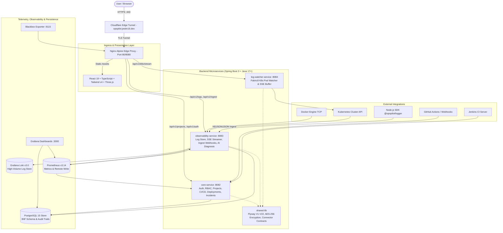

# OpsPilot — AI-Assisted Internal Developer Platform (IDP) & Observability Workbench

[](https://opspilot.jestin16.dev)
[](https://spring.io/projects/spring-boot)
[](https://react.dev/)
[](https://vitejs.dev/)
[](https://tailwindcss.com/)
[](https://www.docker.com/)
[](https://www.postgresql.org/)
[](https://prometheus.io/)
[](https://grafana.com/oss/loki/)

**OpsPilot** is an enterprise-grade Internal Developer Platform (IDP) and intelligent AIOps telemetry workbench designed to unify project workspace isolation, continuous deployment tracking, Docker and Kubernetes cluster telemetry, structured high-throughput log ingestion (NDJSON/JSON), Prometheus metrics, real-time Server-Sent Events (SSE) streaming, and administrative governance into a single cohesive, high-performance web experience.

---

## 🏗️ System Architecture

OpsPilot is engineered as a containerized microservices ecosystem with high-throughput edge routing, encrypted secret vaults, and real-time event streaming:



---

## 🌟 Key Platform Features

### 1. Modern Visual Experience & Landing Showcase
- **Three.js 3D Signal Network**: Dynamic particle and node network visualizer simulating ingress and cluster packet telemetry.
- **Interactive Terminal ASCII Art**: Hand-crafted animated ASCII aesthetic celebrating hacker-first developer tooling.
- **Hero Orbit Animation**: Rotating real-time ecosystem status rings tracking Kubernetes, Docker, and CI/CD states.
- **Responsive Dark Theme**: High-contrast, accessibility-first design system tuned for incident response and long DevOps shifts.

### 2. Multi-Tenant Project Workspace Scoping
- **Strict Tenant Isolation**: Workspaces, live logs, Docker log sources, and metrics are isolated by project ownership.
- **Session Hygiene**: Local storage and query cache partitioning by `user.id` ensures zero data bleed between users.
- **Role-Based Access Control (RBAC)**: Fine-grained permissions for `Admin`, `Developer`, and `DevOps` personas.
- **Admin Governance Portal**: Platform administrators review cross-workspace activity, inspect audit logs, configure quotas, and quarantine suspicious workloads.

### 3. Real-Time Telemetry & Log Streaming
- **Server-Sent Events (SSE)**: Resilient live log tailing using standard `fetch` streams with automatic reconnects and `Last-Event-ID` offset recovery.
- **Virtualized High-Volume Viewer**: Render up to 5,000 log lines in memory with zero UI lag powered by `@tanstack/react-virtual`.
- **Log Source Badges & Level Filtering**: Instant client-side and server-side filtering by service, log level (`DEBUG`, `INFO`, `WARN`, `ERROR`), and regex patterns.

### 4. Comprehensive Infrastructure Connectors
- **Docker Engine API**: Direct TCP communication to discover containers, fetch historical logs, and inspect container health.
- **Kubernetes Cluster Monitoring**: Pod lifecycle management, container log streaming via service-account bearer tokens or in-cluster credentials.
- **CI/CD Integrations**: Native support for GitHub Actions (webhooks, workflow runs, commit timeline) and Jenkins (build status, live console outputs).
- **Encrypted Secret Storage**: All sensitive credentials (tokens, private keys, passwords) are encrypted at rest with **AES-256-GCM**.

### 5. Official Node.js SDK (`@opspilot/logger`)
- Instant log forwarding and console overriding for Node.js / Express / Next.js / Serverless apps with zero boilerplate.

---

## 🗄️ Database Architecture & Flyway Migrations

OpsPilot enforces strict Third Normal Form (3NF) relational integrity across PostgreSQL. Migrations are managed deterministically with **Flyway** (`V1` through `V22` in `shared-lib`):

- **`Users`**: `(user_id PK, name, email UNIQUE, password_hash, created_at)`
- **`Roles`**: `(role_id PK, role_name UNIQUE)` — Pre-seeded: `Admin`, `Developer`, `DevOps`
- **`User_Roles`**: `(user_id FK, role_id FK)`
- **`Projects`**: `(project_id PK, project_name, slug, description, repository_url, owner_id FK->Users, environment, status, created_at)`
- **`Integrations`**: `(integration_id PK, project_id FK->Projects, name, provider, category, status, config_json, encrypted_secrets, created_at)`
- **`Deployments`**: `(deployment_id PK, project_id FK->Projects, deployed_by FK->Users NULLABLE, version, environment, status, url, deployed_at)`
- **`Pipeline_Runs`**: `(run_id PK, project_id FK->Projects, event_type, branch, commit_sha, commit_message, author, status, created_at)`
- **`Logs`**: `(log_id PK, project_id FK->Projects, integration_id FK NULLABLE, source_service, log_level, message, metadata, timestamp)`
- **`Incidents`**: `(incident_id PK, project_id FK->Projects, title, description, severity, status, created_at)`
- **`Audit_Logs`**: `(audit_id PK, user_id FK->Users, action, details, timestamp)`

---

## 📡 REST API Reference

All endpoints are served under `/api/v1/` through the Edge Gateway.

### Authentication & Single Sign-On
| Method | Endpoint | Access | Description |
|---|---|---|---|
| `POST` | `/api/v1/auth/register` | Public | Register new account (`Developer` or `DevOps`) |
| `POST` | `/api/v1/auth/login` | Public | Authenticate with credentials and receive JWT |
| `POST` | `/api/v1/auth/google-login` | Public | Single Sign-On with verified Google OAuth `idToken` |
| `GET` | `/api/v1/auth/me` | Authenticated | Retrieve current session profile and active roles |

### Project Workspace Management
| Method | Endpoint | Access | Description |
|---|---|---|---|
| `GET` | `/api/v1/projects` | Authenticated | List all projects owned by caller |
| `GET` | `/api/v1/projects/{id}` | Authenticated | Retrieve project details |
| `POST` | `/api/v1/projects` | Developer, Admin | Create a new project workspace |
| `PUT` | `/api/v1/projects/{id}` | Owner, Admin | Update project configuration |
| `DELETE` | `/api/v1/projects/{id}` | Owner, Admin | Teardown project workspace and linked resources |

### Connectors & Integrations
| Method | Endpoint | Access | Description |
|---|---|---|---|
| `GET` | `/api/v1/projects/{id}/integrations` | Project Member | List all configured connectors |
| `POST` | `/api/v1/projects/{id}/integrations` | Project Member | Add connector (`DOCKER`, `KUBERNETES`, `GITHUB`, `JENKINS`, `APP_LOGS`) |
| `POST` | `/api/v1/projects/{id}/integrations/{iid}/test` | Project Member | Validate connectivity and update health status |
| `GET` | `/api/v1/projects/{id}/integrations/{iid}/resources` | Project Member | Query available containers, namespaces, or pods |
| `DELETE` | `/api/v1/projects/{id}/integrations/{iid}` | Project Member | Disconnect and purge connector configuration |

### Ingestion & Live Log Streaming
| Method | Endpoint | Access | Description |
|---|---|---|---|
| `POST` | `/api/v1/ingest/{projectId}` | Bearer Token | Ingest application logs (JSON array, NDJSON, plain text) |
| `POST` | `/api/v1/ingest/webhook/{token}` | Webhook Token | External log webhook ingestion URL |
| `POST` | `/api/v1/ingest/{projectId}/deployments` | Bearer Token | CI deployment reporting endpoint |
| `GET` | `/api/v1/projects/{id}/logs` | Project Member | Query historical indexed logs with pagination and filters |
| `GET` | `/api/v1/projects/{id}/logs/stream` | Project Member | Real-time Server-Sent Events (SSE) log stream |

### Platform Administration & Governance
| Method | Endpoint | Access | Description |
|---|---|---|---|
| `GET` | `/api/v1/admin/overview` | Admin | Cross-workspace metrics, user distribution, and health vitals |
| `GET` | `/api/v1/admin/projects` | Admin | Global project registry for containment and governance |
| `GET` | `/api/v1/admin/audit-logs` | Admin | Platform-wide security and operational audit trail |
| `GET` | `/api/v1/admin/settings` | Admin | View rate limiting and system-wide policies |
| `PUT` | `/api/v1/admin/settings` | Admin | Update system policies and ingestion caps |

---

## 📦 Official Node.js SDK (`@opspilot/logger`)

The OpsPilot Node.js SDK allows developers to stream structured application logs to OpsPilot with zero manual log piping:

```bash
npm install opspilot-logger
```

### Usage Example
```javascript
const { initOpsPilot } = require('opspilot-logger');

// Initialize once at the top of your index.js / server.js
initOpsPilot({
  webhookUrl: 'https://opspilot.jestin16.dev/api/v1/ingest/webhook/<YOUR_TOKEN>',
  sourceService: 'orders-microservice',
  batchSize: 10,         // Batch before flushing (default: 10)
  flushIntervalMs: 5000  // Maximum flush delay (default: 5000ms)
});

// All standard console output is captured and sent to OpsPilot
console.log("Order processed successfully", { orderId: "ORD-9481", amount: 149.99 });
console.error("Payment gateway timeout", { gateway: "Stripe", attempt: 3 });
```

---

## 🎨 Locked Dark Theme Design Tokens

OpsPilot adheres strictly to a high-contrast dark theme optimized for technical operations:

| Token Name | Hex Code | Purpose |
|---|---|---|
| **Main Background** | `#060B18` | Root application background |
| **Card Background** | `#0F1B2E` | Container cards, panels, and modal backdrops |
| **Panel Secondary** | `#13233B` | Table headers, dropdown menus, and input fields |
| **Borders** | `#1E2D45` | Component dividers, gridlines, and card borders |
| **Primary Accent** | `#38BDF8` | Buttons, navigation links, and primary signals (Sky Cyan) |
| **AI / Diagnostic Accent** | `#A78BFA` | Root-cause analysis, assistant widgets (Violet) |
| **Warning Accent** | `#F59E0B` | Critical alerts, threshold warnings (Amber) |
| **Primary Text** | `#F8FAFC` | Headings, labels, and table typography |
| **Muted Text** | `#94A3B8` | Subtitles, timestamps, and metadata |

---

## 🚀 Quickstart & Setup Guide

### Option 1: Docker Compose (Recommended)

Start the entire microservices stack with a single command:

```bash
# 1. Clone repository
git clone https://github.com/jestin-16/OpsPilot.git
cd OpsPilot

# 2. Configure environment variables
cp .env.example .env
# Ensure JWT_SECRET and OPSPILOT_ENCRYPTION_KEY are populated:
# openssl rand -base64 48 -> JWT_SECRET
# openssl rand -base64 32 -> OPSPILOT_ENCRYPTION_KEY

# 3. Launch full stack
docker compose up -d
```

#### Access Points:
- **Web Dashboard**: `http://localhost:80` (or `http://localhost:8080`)
- **API Gateway**: `http://localhost:8080/api/v1/`
- **PostgreSQL Database**: `localhost:5432` (`opspilot` / `opspilot`)

#### Optional Monitoring Stack:
Launch Prometheus, Grafana, and Blackbox Exporter:
```bash
docker compose --profile monitoring up -d
```
- **Grafana Dashboard**: `http://localhost:3000` (Default login: `admin` / `${GRAFANA_ADMIN_PASSWORD}`)
- **Prometheus Metrics**: `http://localhost:9090`

---

### Option 2: Local Development Setup

#### Prerequisites
- **Java 17+** (JDK 17 or JDK 21)
- **Maven 3.9+** (or use `./mvnw`)
- **Node.js 18+ & npm**
- **Docker Engine** (for local PostgreSQL and Loki)

#### 1. Start Infrastructure Services
```bash
docker compose up -d postgres loki prometheus
```

#### 2. Run Backend Microservices
```bash
cd backend

# Run Core Service
./mvnw spring-boot:run -pl core-service

# Run Observability Service (in separate terminal)
./mvnw spring-boot:run -pl observability-service

# Run Log Watcher Service (in separate terminal)
./mvnw spring-boot:run -pl log-watcher-service
```

#### 3. Run Frontend Development Server
```bash
cd frontend
npm install
npm run dev
```
The Vite development server will open at `http://localhost:5173`.

---

## 🧪 Automated Testing & Verification

### Frontend Test Suite
Covers authentication forms, virtualized logs, SSE parser, deployment modals, and project creation:
```bash
cd frontend
npm test
```
*Result: 9 test suites, 92+ tests passing.*

### Frontend Production Build & Typecheck
```bash
cd frontend
npm run build
```

### Backend Microservices Tests
Runs unit tests with Flyway migrations against an in-memory test configuration:
```bash
cd backend
./mvnw test
```

---

## 🌐 Production Hosting & Edge Deployment

OpsPilot is hosted in production at **[https://opspilot.jestin16.dev](https://opspilot.jestin16.dev)** using a zero-trust edge topology:
1. **Edge Network**: Cloudflare acts as the global edge proxy, handling SSL termination, DDoS protection, and rate limiting.
2. **Secure Ingress**: Cloudflare Tunnel securely relays traffic directly to the local Nginx ingress container without exposing public ports.
3. **Container Isolation**: Internal microservices communicate over an isolated Docker network.

---

## 📄 License & Authors

OpsPilot is created and maintained by **[jestin-16](https://github.com/jestin-16)**.  
Licensed under the [MIT License](LICENSE).
