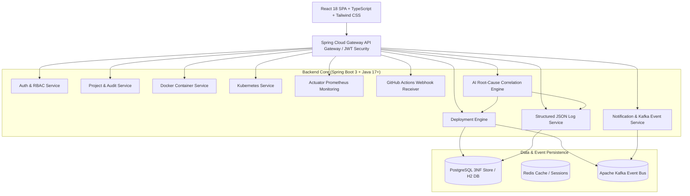

# OpsPilot — AI-Assisted Internal Developer Platform (IDP)

OpsPilot is an enterprise-grade Internal Developer Platform (IDP) designed to unify project management, continuous deployment, Docker container orchestrations, Kubernetes cluster monitoring, Actuator system metrics, structured JSON logging, Kafka event notifications, GitHub Actions webhooks, and AI-assisted root-cause diagnosis into a single cohesive, high-performance web dashboard.

---

## 🏗️ System Architecture



---

## 🗄️ Relational 3NF Database Schema Overview

OpsPilot enforces strict Third Normal Form (3NF) relational integrity across all platform entities:

- **`Users`**: `(user_id PK, name, email UNIQUE, password_hash, created_at)`
- **`Roles`**: `(role_id PK, role_name UNIQUE)` — Pre-seeded roles: `Admin`, `Developer`, `DevOps`
- **`User_Roles`**: `(user_id FK, role_id FK)`
- **`Projects`**: `(project_id PK, project_name, description, repository_url, owner_id FK->Users, status, created_at)`
- **`Deployments`**: `(deployment_id PK, project_id FK->Projects, deployed_by FK->Users, version, environment, status, deployed_at)`
- **`Containers`**: `(container_id PK, deployment_id FK->Deployments, image_name, container_status, created_at)`
- **`Pods`**: `(pod_id PK, container_id FK->Containers, node_name, pod_status, cpu_usage, memory_usage)`
- **`Logs`**: `(log_id PK, deployment_id FK->Deployments NULLABLE, source_service, log_level, message, timestamp)`
- **`Notifications`**: `(notification_id PK, user_id FK->Users NULLABLE, deployment_id FK->Deployments NULLABLE, message, type, is_read, created_at)`
- **`Pipeline_Runs`**: `(run_id PK, project_id FK->Projects, event_type, branch, commit_sha, commit_message, author, status, created_at)`
- **`Audit_Logs`**: `(audit_id PK, user_id FK->Users, action, details, timestamp)`

---

## 📡 REST API Reference

### Email verification configuration

New registrations require email verification before login. Configure these environment variables for the auth service; never commit SMTP credentials:

```text
MAIL_HOST=smtp.example.com
MAIL_PORT=587
MAIL_USERNAME=your-smtp-user
MAIL_PASSWORD=your-smtp-password
MAIL_FROM=no-reply@example.com
MAIL_AUTH=true
MAIL_STARTTLS=true
OTP_EXPIRATION_MINUTES=5
OTP_MAX_ATTEMPTS=5
OTP_RESEND_COOLDOWN_SECONDS=60
```

The signup flow is `POST /api/auth/register`, `POST /api/auth/verify-otp`, then normal `POST /api/auth/login`. Existing users are treated as verified by the migration default.

### Authentication & RBAC
| Method | Endpoint | Access | Description |
|---|---|---|---|
| `POST` | `/api/auth/register` | Public | Register a new user (`Admin`, `Developer`, `DevOps`) |
| `POST` | `/api/auth/login` | Public | Authenticate user and issue JWT token |

### Project Management
| Method | Endpoint | Access | Description |
|---|---|---|---|
| `GET` | `/api/projects` | Authenticated | List all projects |
| `GET` | `/api/projects/{id}` | Authenticated | Get project details |
| `POST` | `/api/projects` | Admin, Developer | Create a new microservice project |
| `PUT` | `/api/projects/{id}` | Project Owner / Admin | Update project details |
| `DELETE` | `/api/projects/{id}` | Project Owner / Admin | Delete project |

### Deployment Engine
| Method | Endpoint | Access | Description |
|---|---|---|---|
| `GET` | `/api/projects/{id}/deployments` | Authenticated | Get deployment history for a project |
| `POST` | `/api/projects/{id}/deployments` | Admin, Developer | Trigger a deployment pipeline |

### Infrastructure Management
| Method | Endpoint | Access | Description |
|---|---|---|---|
| `GET` | `/api/docker/containers` | Authenticated | List active Docker containers |
| `POST` | `/api/docker/containers/{id}/start` | DevOps, Admin | Start a Docker container |
| `POST` | `/api/docker/containers/{id}/stop` | DevOps, Admin | Stop a Docker container |
| `POST` | `/api/docker/containers/{id}/restart` | DevOps, Admin | Restart a Docker container |
| `GET` | `/api/kubernetes/pods` | Authenticated | List Minikube / K8s pods |

### Monitoring, Logs & Notifications
| Method | Endpoint | Access | Description |
|---|---|---|---|
| `GET` | `/api/monitoring/metrics` | Authenticated | Get Actuator CPU, memory & HTTP metrics |
| `GET` | `/api/logs` | Authenticated | Search structured JSON logs by service/level/query |
| `POST` | `/api/logs` | Authenticated | Ingest custom log entries |
| `GET` | `/api/notifications` | Authenticated | Get Kafka deployment event notifications |
| `PUT` | `/api/notifications/{id}/read` | Authenticated | Mark notification as read |

### CI/CD & AI Assistant
| Method | Endpoint | Access | Description |
|---|---|---|---|
| `POST` | `/api/webhooks/github` | Public | Webhook listener for GitHub Actions push/workflow events |
| `GET` | `/api/cicd/runs` | Authenticated | Fetch GitHub Actions pipeline runs |
| `POST` | `/api/ai/query` | Authenticated | Run timestamp-correlation AI root cause diagnosis |

---

## 🧭 Project-first flow: connect, then watch

Everything starts with a **project**. Inside it you connect the systems you care about and watch all their logs in one live dashboard.

1. **Create a project** (`/projects` → *Create Project*): name, environment (`dev` / `staging` / `prod`), optional repository.
2. **Connect integrations** (`/projects/:id/integrations`): each card has *Connect*, *Configure*, *Test* and *Disconnect*.
3. **Watch logs**: `/projects/:id/logs` is one stream for every source (filters: source, level, time range, text; pause/resume, auto-scroll, source badges, colour-coded levels). `/projects/:id/logs/:integrationId` is a dedicated page per integration.

The project switcher in the sidebar keeps the selection. Existing global pages (`/logs`, `/pipelines`, `/deployments`, `/incidents`, `/github`) follow the selected project, and a banner offers *Show all projects*. Data created before this flow is moved into a **Default Project** by migration `V15`.

### Integrations

| Type | Reads from | Settings (secrets in *italics*) | Notes |
|---|---|---|---|
| **Docker** | Docker Engine API over TCP | `host`, `containers`, *`caCert`* | Container picker on its page. Unix sockets are not supported; expose the API over TCP or a socket proxy. |
| **Kubernetes** | Kubernetes API | `apiServer`, `namespace`, `podName`, `labelSelector`, `container`, *`token`*, *`caCert`* | Uses the in-cluster service account when no `apiServer` is set. Needs `get/list pods` and `get pods/log`. Kubeconfig files are not parsed; use a service-account token. |
| **Git** (`GITHUB`) | GitHub REST API + webhooks | `repo`, `apiBaseUrl`, `pollSeconds`, *`token`*, *`webhookSecret`* | Pushes, pull requests, workflow runs as a timeline. GitLab is not implemented. |
| **CI/CD** | GitHub Actions or Jenkins | GitHub: `repo`, *`token`*. Jenkins: `baseUrl`, `job`, *`username`*, *`apiToken`* | Run list; opening a run reads its jobs/steps (GitHub) or console (Jenkins). The Jenkins live stream reports build state changes. |
| **App Logs** | Pushed by your app | `app` | An ingest token is shown **once** at creation. |

Secrets are split from settings by the server, encrypted at rest (AES-256-GCM), never returned by any API, and masked in error messages and log lines. Editing an integration keeps stored secrets unless you send new ones.

### Sending application logs

```bash
curl -X POST "$API/api/v1/ingest/{projectId}" \
  -H "Authorization: Bearer opl_..." -H "Content-Type: application/json" \
  -d '[{"level":"ERROR","message":"payment failed","order_id":"A-1042"}]'
```

Accepts a JSON object, an array, `{"logs":[...]}`, NDJSON, or plain text (one entry per line); up to 1,000 entries and `INGEST_MAX_BODY_BYTES` per request. `message`, `level` and `timestamp` (ISO-8601 or epoch seconds/ms) are understood; other simple fields become searchable metadata. The integration page shows a ready-made Django logging handler.

GitHub webhooks (optional, for instant Git events): payload URL `/api/v1/ingest/{projectId}/github/{integrationId}`, content type JSON, secret = the integration's `webhookSecret`. Deliveries are verified with `X-Hub-Signature-256`.

### Project, integration and log API

All paths also exist under `/api/projects/...` (without `v1`).

| Method | Endpoint | Description |
|---|---|---|
| `POST` `GET` `PUT` `DELETE` | `/api/v1/projects[/{id}]` | Project CRUD (`name`, `description`, `environment`, `repositoryUrl`; `slug` is generated) |
| `GET` `POST` | `/api/v1/projects/{id}/integrations` | List / create (`provider`, `name`, `category`, `config{}`, `secrets{}`) |
| `GET` `PUT` `DELETE` | `/api/v1/projects/{id}/integrations/{iid}` | Read / update / delete |
| `POST` | `.../integrations/{iid}/test` | Run the connection test; returns the integration with `status` and `statusMessage` |
| `POST` | `.../integrations/{iid}/disconnect` | Stop collecting |
| `GET` | `.../integrations/{iid}/resources?kind=containers\|namespaces\|pods` | Pickers |
| `GET` | `.../integrations/{iid}/history?...` | Read straight from the source (selectors: `container`, `namespace`, `pod`, `run`, `build`) |
| `GET` | `/api/v1/projects/{id}/logs?integrationId&type&level&from&to&q&container&namespace&pod&page&size` | Stored logs, newest first |
| `GET` | `/api/v1/projects/{id}/logs/stream?...` | Server-sent events with the same filters; 15 s keepalive; honours `Last-Event-ID` to replay what was missed |
| `POST` | `/api/v1/ingest/{projectId}` | Push logs (Bearer ingest token) |

### How it fits together

- **core-service** owns projects and integrations, the `IntegrationConnector` implementations' *test / discover / history* calls, and encrypted credentials.
- **observability-service** owns the log store: it runs a `ConnectorRunner` that follows every `CONNECTED` pull integration (reconnecting with backoff), accepts pushes, serves the query and SSE endpoints, and fans new lines out to live viewers.
- Connectors implement `IntegrationConnector` (`testConnection`, `streamLogs`, `fetchHistory`) in `shared-lib`, so a new source type is one class plus a form definition in `frontend/src/lib/integrationTypes.ts`.
- The browser reads the stream with `fetch` (not `EventSource`, which cannot send the `Authorization` header), reconnects automatically, and resumes from the last event id. At most 5,000 lines are kept in memory and the list is virtualized.

### Configuration

| Variable | Service | Default | Purpose |
|---|---|---|---|
| `OPSPILOT_ENCRYPTION_KEY` | core, observability | dev-only fallback | Key for integration secrets. **Set it in production**; changing it makes stored secrets unreadable. `openssl rand -base64 32` |
| `LOGS_RUNNER_ENABLED` | observability | `true` | Follow pull integrations (set `false` on replicas that should only serve reads) |
| `LOGS_RUNNER_INTERVAL_MS` | observability | `30000` | How often to look for new / changed / disconnected integrations |
| `LOGS_RUNNER_REFRESH` | observability | `10m` | Re-resolve containers and pods for Docker / Kubernetes streams |
| `INGEST_MAX_BODY_BYTES` | observability | `5242880` | Largest accepted push body |
| `VITE_API_BASE_URL` | frontend | `http://localhost:8080/api/v1` | API gateway URL |

Integration endpoints are fetched by the server, so only point them at hosts you trust; `http(s)` only, and link-local addresses (cloud metadata) are refused.

---

## 🎨 Locked Dark Theme Design System

OpsPilot strictly implements a high-contrast dark theme optimized for DevOps operations:

| Token Name | Hex Code | Usage |
|---|---|---|
| Main Background | `#060B18` | Application background |
| Card Background | `#0F1B2E` | Component cards and panels |
| Panel Secondary | `#13233B` | Input fields, dropdowns, and table headers |
| Borders | `#1E2D45` | Card and divider borders |
| Primary Accent | `#38BDF8` | Buttons, links, primary indicators (Cyan) |
| AI Accent | `#A78BFA` | AI Assistant badges, cards, and highlights (Violet) |
| Warning Accent | `#F59E0B` | Warning badges and alerts (Amber) |
| Primary Text | `#F8FAFC` | Headings, labels, and table content |
| Muted Text | `#94A3B8` | Subtitles, metadata, and placeholder text |

---

## 🚀 Quickstart Run Instructions

### Prerequisites
- Java 17+ / Java 26
- Maven 3.9+ (`./mvnw`)
- Node.js 18+ & npm

### 1. Run Spring Boot Backend
```bash
cd backend
./mvnw spring-boot:run -Dspring-boot.run.profiles=h2
```
The backend server runs on `http://localhost:8080`.

### 2. Run React Frontend
```bash
cd frontend
npm install
npm run dev
```
The frontend application will be accessible at `http://localhost:5173`.

---

## 🧪 Test Suite Execution

- **Backend Unit Tests**:
  ```bash
  cd backend && ./mvnw test
  ```
- **Frontend Typecheck & Production Build**:
  ```bash
  cd frontend && npm run build
  ```
- **Frontend Unit Tests** (SSE parser, reconnect/resume, log buffer, integration forms):
  ```bash
  cd frontend && npm test
  ```
