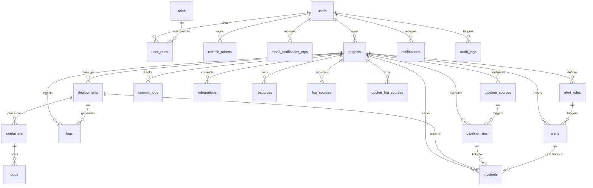

# OpsPilot Database Schema Specification

## 1. Overview & Architecture

OpsPilot utilizes a **Project-First, Multi-Tenant Relational Schema** hosted on PostgreSQL. All operational assets, telemetry streams, infrastructure containers, Kubernetes workloads, CI/CD pipelines, incidents, and logs are tied back to scoped `projects` and authenticated `users`.

### Entity Relationship Diagram (ERD)

---

## 2. Table Dictionaries by Subsystem

### Subsystem 1: Identity, Authentication & Governance

#### 1. `users`
Stores user profile, credentials, and verification status.

| Column | Type | Constraints | Description |
| :--- | :--- | :--- | :--- |
| `id` | `BIGSERIAL` | **PRIMARY KEY**, NOT NULL | Unique User identifier |
| `name` | `VARCHAR(255)` | NOT NULL | Full name of the user |
| `email` | `VARCHAR(255)` | NOT NULL, **UNIQUE** | User login email address |
| `password_hash` | `VARCHAR(255)` | NOT NULL | BCrypt hashed password |
| `is_active` | `BOOLEAN` | NOT NULL, DEFAULT `TRUE` | Whether user account is active |
| `email_verified`| `BOOLEAN` | NOT NULL, DEFAULT `TRUE` | Email verification flag |
| `created_at` | `TIMESTAMP` | NOT NULL, DEFAULT `CURRENT_TIMESTAMP` | Account creation timestamp |

#### 2. `roles`
System-defined RBAC authorization roles (`ADMIN`, `DEVELOPER`, `VIEWER`).

| Column | Type | Constraints | Description |
| :--- | :--- | :--- | :--- |
| `id` | `BIGSERIAL` | **PRIMARY KEY**, NOT NULL | Role identifier |
| `role_name` | `VARCHAR(255)` | NOT NULL, **UNIQUE** | Role identifier (e.g., `ROLE_ADMIN`, `ROLE_USER`) |
| `description` | `VARCHAR(255)` | NULLABLE | Human-readable role description |

#### 3. `user_roles`
Join table establishing Many-to-Many mapping between users and roles.

| Column | Type | Constraints | Description |
| :--- | :--- | :--- | :--- |
| `user_id` | `BIGINT` | NOT NULL, **FK** ➔ `users(id)` ON DELETE CASCADE | Target user |
| `role_id` | `BIGINT` | NOT NULL, **FK** ➔ `roles(id)` ON DELETE CASCADE | Assigned role |
| *Composite PK* | `(user_id, role_id)` | **PRIMARY KEY** | Composite unique constraint |

#### 4. `refresh_tokens`
Maintains long-lived JWT refresh sessions.

| Column | Type | Constraints | Description |
| :--- | :--- | :--- | :--- |
| `id` | `BIGSERIAL` | **PRIMARY KEY**, NOT NULL | Token record ID |
| `token` | `VARCHAR(255)` | NOT NULL, **UNIQUE** | Opaque secure refresh token string |
| `user_id` | `BIGINT` | NOT NULL, **FK** ➔ `users(id)` ON DELETE CASCADE | Associated user |
| `expiry_date` | `TIMESTAMPTZ` | NOT NULL | Token expiration timestamp (UTC) |

#### 5. `email_verification_otps`
Handles one-time passcode verification for user registration.

| Column | Type | Constraints | Description |
| :--- | :--- | :--- | :--- |
| `id` | `BIGSERIAL` | **PRIMARY KEY**, NOT NULL | OTP record ID |
| `user_id` | `BIGINT` | NOT NULL, **FK** ➔ `users(id)` ON DELETE CASCADE | Associated user |
| `otp_hash` | `VARCHAR(255)` | NOT NULL | SHA-256 hashed OTP code |
| `expires_at` | `TIMESTAMP` | NOT NULL | Expiry time |
| `attempts` | `INTEGER` | NOT NULL, DEFAULT `0` | Failed attempts counter |
| `used` | `BOOLEAN` | NOT NULL, DEFAULT `FALSE` | Single-use flag |
| `created_at` | `TIMESTAMP` | NOT NULL, DEFAULT `CURRENT_TIMESTAMP` | Timestamp generated |

#### 6. `audit_logs`
System-wide security and compliance audit logging.

| Column | Type | Constraints | Description |
| :--- | :--- | :--- | :--- |
| `id` | `BIGSERIAL` | **PRIMARY KEY**, NOT NULL | Audit log ID |
| `user_id` | `BIGINT` | NULLABLE, **FK** ➔ `users(id)` ON DELETE SET NULL | Initiating user |
| `action` | `VARCHAR(255)` | NOT NULL | Action performed (e.g., `DEPLOY_TRIGGER`, `PROJECT_UPDATE`) |
| `resource_type` | `VARCHAR(255)` | NOT NULL | Target entity type (`PROJECT`, `INTEGRATION`) |
| `resource_id` | `VARCHAR(255)` | NULLABLE | Identifier of affected entity |
| `details` | `TEXT` | NULLABLE | JSON context or diff |
| `timestamp` | `TIMESTAMP` | NOT NULL, DEFAULT `CURRENT_TIMESTAMP` | Audit event time |

#### 7. `platform_settings`
Global system configurations and key-value store.

| Column | Type | Constraints | Description |
| :--- | :--- | :--- | :--- |
| `id` | `BIGSERIAL` | **PRIMARY KEY**, NOT NULL | Setting ID |
| `setting_key` | `VARCHAR(255)` | NOT NULL, **UNIQUE** | Configuration key |
| `setting_value`| `TEXT` | NOT NULL | Configuration value (JSON or string) |
| `updated_at` | `TIMESTAMP` | NOT NULL, DEFAULT `CURRENT_TIMESTAMP` | Modification timestamp |

#### 8. `platform_integrations`
System-wide global cloud/tool connectors.

| Column | Type | Constraints | Description |
| :--- | :--- | :--- | :--- |
| `id` | `BIGSERIAL` | **PRIMARY KEY**, NOT NULL | Integration ID |
| `provider_type`| `VARCHAR(255)` | NOT NULL | Cloud/tool type (`AWS`, `GITHUB`, `DOCKER`) |
| `name` | `VARCHAR(255)` | NOT NULL | Display name |
| `config_json` | `TEXT` | NULLABLE | Encrypted credentials or connection details |
| `active` | `BOOLEAN` | NOT NULL, DEFAULT `TRUE` | Enable/disable toggle |
| `created_at` | `TIMESTAMP` | NOT NULL, DEFAULT `CURRENT_TIMESTAMP` | Created timestamp |

---

### Subsystem 2: Workspace & Project Management

#### 9. `projects`
The central multi-tenant container for all services and telemetry.

| Column | Type | Constraints | Description |
| :--- | :--- | :--- | :--- |
| `id` | `BIGSERIAL` | **PRIMARY KEY**, NOT NULL | Project ID |
| `slug` | `VARCHAR(120)` | NOT NULL, **UNIQUE** | URL-safe slug (e.g. `payment-service-1`) |
| `project_name` | `VARCHAR(255)` | NOT NULL | Display name |
| `description` | `TEXT` | NULLABLE | Description |
| `environment` | `VARCHAR(20)` | NOT NULL, DEFAULT `'dev'` | Stage: `dev`, `staging`, `prod` |
| `repository_url`| `VARCHAR(512)`| NULLABLE | Git remote repository URL |
| `owner_id` | `BIGINT` | NOT NULL, **FK** ➔ `users(id)` ON DELETE CASCADE | Project owner |
| `status` | `VARCHAR(255)` | NOT NULL, DEFAULT `'Active'` | Lifecycle status |
| `github_repo_name` | `VARCHAR(255)` | NULLABLE | GitHub repo identifier |
| `aws_log_group_name` | `VARCHAR(255)` | NULLABLE | AWS CloudWatch log group |
| `oci_log_group_ocid` | `VARCHAR(255)` | NULLABLE | Oracle Cloud Log Group OCID |
| `loki_app_label` | `VARCHAR(255)` | NULLABLE | Grafana Loki selector |
| `credentials_json` | `TEXT` | NULLABLE | Encrypted project secrets |
| `created_at` | `TIMESTAMP` | NOT NULL, DEFAULT `CURRENT_TIMESTAMP` | Project creation time |

---

### Subsystem 3: Deployments & Orchestration (Containers & Pods)

#### 10. `deployments`
Tracks software releases across environments.

| Column | Type | Constraints | Description |
| :--- | :--- | :--- | :--- |
| `id` | `BIGSERIAL` | **PRIMARY KEY**, NOT NULL | Deployment ID |
| `project_id` | `BIGINT` | NOT NULL, **FK** ➔ `projects(id)` ON DELETE CASCADE | Associated project |
| `version` | `VARCHAR(255)` | NOT NULL | Semantic version / tag |
| `environment` | `VARCHAR(255)` | NOT NULL | `dev`, `staging`, `prod` |
| `status` | `VARCHAR(255)` | NOT NULL | `PENDING`, `IN_PROGRESS`, `DEPLOYED`, `FAILED` |
| `source` | `VARCHAR(30)` | NOT NULL, DEFAULT `'MANUAL'` | Trigger source: `MANUAL`, `GITHUB`, `JENKINS`, `SIMULATED` |
| `external_id` | `VARCHAR(255)` | NULLABLE | Provider deployment ID |
| `url` | `VARCHAR(1024)`| NULLABLE | Public application URL |
| `actor` | `VARCHAR(255)` | NULLABLE | Username or system agent |
| `deployed_by_id`| `BIGINT` | NULLABLE, **FK** ➔ `users(id)` | User who triggered deployment |
| `deployed_at` | `TIMESTAMP` | NOT NULL, DEFAULT `CURRENT_TIMESTAMP` | Deployment start time |
| `updated_at` | `TIMESTAMP(6)` | NULLABLE | Last status update timestamp |

#### 11. `containers`
Docker container runtime instances.

| Column | Type | Constraints | Description |
| :--- | :--- | :--- | :--- |
| `container_id` | `BIGSERIAL` | **PRIMARY KEY**, NOT NULL | Container ID |
| `deployment_id`| `BIGINT` | NULLABLE, **FK** ➔ `deployments(id)` ON DELETE SET NULL | Linked release |
| `image_name` | `VARCHAR(255)` | NOT NULL | Image repository and tag |
| `container_status`| `VARCHAR(255)`| NOT NULL | Status (`RUNNING`, `EXITED`, `CRASHED`) |
| `created_at` | `TIMESTAMP` | NOT NULL, DEFAULT `CURRENT_TIMESTAMP` | Launch timestamp |

#### 12. `pods`
Kubernetes Pod workloads and real-time metrics.

| Column | Type | Constraints | Description |
| :--- | :--- | :--- | :--- |
| `pod_id` | `BIGSERIAL` | **PRIMARY KEY**, NOT NULL | Pod record ID |
| `container_id` | `BIGINT` | NULLABLE, **FK** ➔ `containers(container_id)` ON DELETE SET NULL | Container inside pod |
| `pod_name` | `VARCHAR(255)` | NULLABLE | Kubernetes metadata pod name |
| `namespace` | `VARCHAR(255)` | NULLABLE | Kubernetes namespace |
| `node_name` | `VARCHAR(255)` | NOT NULL | Worker node host |
| `pod_status` | `VARCHAR(255)` | NOT NULL | `Running`, `Pending`, `CrashLoopBackOff` |
| `cpu_usage` | `VARCHAR(255)` | NULLABLE | CPU usage (e.g. `150m`) |
| `memory_usage` | `VARCHAR(255)` | NULLABLE | Memory usage (e.g. `256Mi`) |

#### 13. `resources`
Discovered cloud and infrastructure assets across integrations.

| Column | Type | Constraints | Description |
| :--- | :--- | :--- | :--- |
| `id` | `BIGSERIAL` | **PRIMARY KEY**, NOT NULL | Resource record ID |
| `project_id` | `BIGINT` | NOT NULL | Project scope |
| `integration_id`| `BIGINT` | NULLABLE | Linked integration |
| `name` | `VARCHAR(255)` | NOT NULL | Asset name |
| `resource_type` | `VARCHAR(255)` | NOT NULL | `K8S_POD`, `EC2`, `S3`, `RDS` |
| `provider` | `VARCHAR(255)` | NOT NULL | `AWS`, `KUBERNETES`, `DOCKER`, `OCI` |
| `provider_resource_id`| `VARCHAR(255)`| NOT NULL | Cloud provider ARN / ID |
| `region` | `VARCHAR(255)` | NULLABLE | Cloud region |
| `environment` | `VARCHAR(255)` | NULLABLE | Environment |
| `status` | `VARCHAR(255)` | NOT NULL | Operational status |
| `metadata` | `TEXT` | NULLABLE | JSON properties |
| `created_at` / `updated_at` | `TIMESTAMP(6)` | NOT NULL | Lifecycle timestamps |

---

### Subsystem 4: CI/CD Pipelines & Source Control

#### 14. `pipeline_sources`
Registers external CI/CD engines (GitHub Actions, Jenkins).

| Column | Type | Constraints | Description |
| :--- | :--- | :--- | :--- |
| `id` | `BIGSERIAL` | **PRIMARY KEY**, NOT NULL | Source ID |
| `project_id` | `BIGINT` | NULLABLE, **FK** ➔ `projects(id)` ON DELETE SET NULL | Project scope |
| `name` | `VARCHAR(255)` | NOT NULL | Display name |
| `provider` | `VARCHAR(50)` | NOT NULL | `GITHUB_ACTIONS` or `JENKINS` |
| `enabled` | `BOOLEAN` | NOT NULL, DEFAULT `TRUE` | Active listener switch |
| `repo_full_name`| `VARCHAR(255)`| NULLABLE | GitHub `org/repo` |
| `access_token` | `TEXT` | NULLABLE | API credential |
| `base_url` / `job_name` | `VARCHAR` | NULLABLE | Jenkins server URL and job name |
| `webhook_secret`| `TEXT` | NOT NULL | Webhook verification secret |
| `created_at` / `updated_at` | `TIMESTAMP` | NOT NULL, DEFAULT `CURRENT_TIMESTAMP` | Audit timestamps |

#### 15. `pipeline_runs`
Workflow execution history and telemetry.

| Column | Type | Constraints | Description |
| :--- | :--- | :--- | :--- |
| `run_id` | `BIGSERIAL` | **PRIMARY KEY**, NOT NULL | Run record ID |
| `project_id` | `BIGINT` | NULLABLE, **FK** ➔ `projects(id)` ON DELETE CASCADE | Associated project |
| `source_id` | `BIGINT` | NULLABLE, **FK** ➔ `pipeline_sources(id)` ON DELETE SET NULL | Origin source |
| `event_type` | `VARCHAR(255)` | NOT NULL | `push`, `pull_request`, `workflow_dispatch` |
| `branch` | `VARCHAR(255)` | NOT NULL | Git branch |
| `commit_sha` | `VARCHAR(255)` | NOT NULL | Git commit SHA |
| `commit_message`| `TEXT` | NULLABLE | Commit message |
| `author` | `VARCHAR(255)` | NOT NULL | Committer name |
| `status` | `VARCHAR(255)` | NOT NULL | `SUCCESS`, `FAILURE`, `RUNNING`, `CANCELLED` |
| `build_logs` | `TEXT` | NULLABLE | Full console build output |
| `duration_ms` | `BIGINT` | NULLABLE | Execution duration in ms |
| `exit_code` | `INTEGER` | NULLABLE | Process exit code (`0` for success) |
| `created_at` | `TIMESTAMP` | NOT NULL, DEFAULT `CURRENT_TIMESTAMP` | Start time |

#### 16. `commit_logs`
Tracks code repository commits and metadata for deployment traceability.

| Column | Type | Constraints | Description |
| :--- | :--- | :--- | :--- |
| `commit_log_id`| `BIGSERIAL` | **PRIMARY KEY**, NOT NULL | Commit log ID |
| `project_id` | `BIGINT` | NULLABLE, **FK** ➔ `projects(id)` | Scoped project |
| `author` | `VARCHAR(255)` | NOT NULL | Committer name |
| `branch_name` | `VARCHAR(255)` | NOT NULL | Branch name |
| `commit_sha` | `VARCHAR(255)` | NOT NULL | Commit hash |
| `message` | `VARCHAR(2048)`| NOT NULL | Commit log summary |
| `timestamp` | `TIMESTAMP(6)` | NOT NULL | Commit timestamp |

---

### Subsystem 5: Observability & Log Management

#### 17. `logs` (Unified Log Store)
Centralized repository for all ingested application, container, and cloud logs.

| Column | Type | Constraints | Description |
| :--- | :--- | :--- | :--- |
| `log_id` | `BIGSERIAL` | **PRIMARY KEY**, NOT NULL | Log record ID |
| `project_id` | `BIGINT` | NULLABLE, **FK** ➔ `projects(id)` | Project association |
| `integration_id`| `BIGINT` | NULLABLE | Originating connector |
| `deployment_id` | `BIGINT` | NULLABLE, **FK** ➔ `deployments(id)` ON DELETE SET NULL | Associated deployment |
| `source_service`| `VARCHAR(255)`| NOT NULL | Service / Container label |
| `source_type` | `VARCHAR(30)` | NULLABLE | `CONTAINER`, `K8S`, `API` |
| `log_level` | `VARCHAR(255)` | NOT NULL | `INFO`, `WARN`, `ERROR`, `DEBUG`, `FATAL` |
| `message` | `TEXT` | NOT NULL | Log message or stack trace |
| `metadata` | `TEXT` | NULLABLE | Freeform JSON key-value attributes |
| `timestamp` | `TIMESTAMP` | NOT NULL, DEFAULT `CURRENT_TIMESTAMP` | Event timestamp |

#### 18. `log_sources`
Registers polling endpoints and webhooks for log ingestion.

| Column | Type | Constraints | Description |
| :--- | :--- | :--- | :--- |
| `source_id` | `BIGSERIAL` | **PRIMARY KEY**, NOT NULL | Log source ID |
| `project_id` | `BIGINT` | NULLABLE, **FK** ➔ `projects(id)` ON DELETE CASCADE | Scoped project |
| `public_id` | `VARCHAR(255)` | NULLABLE | Client-visible identifier |
| `source_name` | `VARCHAR(255)` | NOT NULL | Source name |
| `ingestion_mode`| `VARCHAR(255)`| NOT NULL | `POLL` or `WEBHOOK` |
| `field_mapping`| `JSONB` | NOT NULL | JSON schema mappings |
| `auth_method` | `VARCHAR(255)` | NOT NULL | `NONE`, `BEARER_TOKEN`, `API_KEY` |
| `auth_config` | `JSONB` | NULLABLE | Authentication payload |
| `poll_endpoint_url`| `VARCHAR(500)`| NULLABLE | Target polling endpoint |
| `poll_interval_seconds`| `INT` | DEFAULT `60` | Polling frequency |
| `is_active` | `BOOLEAN` | DEFAULT `TRUE` | Enable/disable toggle |
| `created_at` | `TIMESTAMP` | NOT NULL, DEFAULT `CURRENT_TIMESTAMP` | Created timestamp |

#### 19. `docker_log_sources`
Push-model Docker monitoring sources authenticated via SHA-256 tokens (Grafana Alloy).

| Column | Type | Constraints | Description |
| :--- | :--- | :--- | :--- |
| `id` | `UUID` | **PRIMARY KEY**, NOT NULL | Unique Source UUID |
| `project_id` | `BIGINT` | NOT NULL, **FK** ➔ `projects(id)` ON DELETE CASCADE | Scoped project |
| `name` | `VARCHAR(100)` | NOT NULL | Service name |
| `environment` | `VARCHAR(32)` | NOT NULL | Environment stage |
| `type` | `VARCHAR(20)` | NOT NULL, DEFAULT `'DOCKER'` | Source type |
| `token_hash` | `VARCHAR(64)` | NOT NULL, **UNIQUE** | SHA-256 hash of access token |
| `token_prefix` | `VARCHAR(16)` | NOT NULL | Token prefix for identification |
| `status` | `VARCHAR(20)` | NOT NULL, DEFAULT `'WAITING'` | `WAITING`, `ACTIVE`, `STALE` |
| `last_seen_at` | `TIMESTAMP` | NULLABLE | Last heartbeat timestamp |
| `created_at` | `TIMESTAMP` | NOT NULL, DEFAULT `CURRENT_TIMESTAMP` | Record creation time |

#### 20. `infrastructure_events`
Asynchronous events emitted by cloud providers or orchestration platforms.

| Column | Type | Constraints | Description |
| :--- | :--- | :--- | :--- |
| `id` | `VARCHAR(255)` | **PRIMARY KEY**, NOT NULL | Event ID |
| `timestamp` | `TIMESTAMP` | NOT NULL | Event generation time |
| `project_id` | `BIGINT` | NULLABLE | Project association |
| `integration_id`| `BIGINT` | NULLABLE | Originating integration |
| `provider` | `VARCHAR(255)` | NULLABLE | `AWS`, `KUBERNETES`, `OCI` |
| `resource_id` | `VARCHAR(255)` | NULLABLE | Affected resource ID |
| `event_type` | `VARCHAR(255)` | NULLABLE | Event classification |
| `severity` | `VARCHAR(255)` | NULLABLE | `INFO`, `WARNING`, `CRITICAL` |
| `message` | `TEXT` | NULLABLE | Event payload / details |
| `metadata` | `TEXT` | NULLABLE | Raw JSON payload |

---

### Subsystem 6: Third-Party Integrations & Connectors

#### 21. `integrations`
Connected external services (Datadog, AWS, Kubernetes, Loki).

| Column | Type | Constraints | Description |
| :--- | :--- | :--- | :--- |
| `id` | `BIGSERIAL` | **PRIMARY KEY**, NOT NULL | Integration ID |
| `project_id` | `BIGINT` | NOT NULL, **FK** ➔ `projects(id)` ON DELETE CASCADE | Associated project |
| `provider` | `VARCHAR(255)` | NOT NULL | Provider (`KUBERNETES`, `AWS`, `DOCKER`) |
| `name` | `VARCHAR(255)` | NOT NULL | Integration display name |
| `category` | `VARCHAR(255)` | NOT NULL | `OBSERVABILITY`, `CLOUD`, `CI_CD` |
| `status` | `VARCHAR(255)` | NOT NULL | `CONNECTED`, `DISCONNECTED`, `ERROR` |
| `configuration`| `TEXT` | NULLABLE | Encrypted connection params |
| `credential_reference`| `TEXT`| NULLABLE | Secret manager reference / Vault key |
| `ingest_token_hash`| `VARCHAR(64)`| NULLABLE, **UNIQUE** | Ingestion token hash |
| `ingest_token_prefix`| `VARCHAR(16)`| NULLABLE | Ingestion token display prefix |
| `metadata` | `TEXT` | NULLABLE | Extra connector metadata |
| `last_health_check_at`| `TIMESTAMP`| NULLABLE | Last health probe time |
| `created_at` / `updated_at` | `TIMESTAMP` | NOT NULL, DEFAULT `CURRENT_TIMESTAMP` | Record timestamps |

---

### Subsystem 7: Alerting, Incident Management & Notifications

#### 22. `alert_rules`
Defines dynamic thresholds and conditions to trigger operational alerts.

| Column | Type | Constraints | Description |
| :--- | :--- | :--- | :--- |
| `id` | `BIGSERIAL` | **PRIMARY KEY**, NOT NULL | Rule ID |
| `project_id` | `BIGINT` | NULLABLE | Scoped project (NULL = Global rule) |
| `integration_id`| `BIGINT` | NULLABLE | Scoped integration |
| `resource` | `VARCHAR(255)` | NULLABLE | Target resource pattern |
| `event_type` | `VARCHAR(255)` | NOT NULL | `PIPELINE_FAILED`, `POD_CRASHED`, `REPEATED_ERROR_LOGS` |
| `severity` | `VARCHAR(255)` | NOT NULL | `CRITICAL`, `WARNING`, `INFO` |
| `threshold` | `INT` | NOT NULL, DEFAULT `1` | Occurrences required to fire |
| `time_window` | `INT` | NOT NULL, DEFAULT `5` | Evaluation window (minutes) |
| `enabled` | `BOOLEAN` | NOT NULL, DEFAULT `TRUE` | Rule active toggle |
| `notification_policy`| `VARCHAR(255)`| NULLABLE | Notification routing target |

#### 23. `alerts`
Concrete alert instances raised by the rules engine.

| Column | Type | Constraints | Description |
| :--- | :--- | :--- | :--- |
| `id` | `BIGSERIAL` | **PRIMARY KEY**, NOT NULL | Alert record ID |
| `alert_rule_id`| `BIGINT` | NULLABLE | Originating rule ID |
| `project_id` | `BIGINT` | NULLABLE | Affected project |
| `resource` | `VARCHAR(255)` | NULLABLE | Resource identifier |
| `event_type` | `VARCHAR(255)` | NOT NULL | Event classification |
| `message` | `TEXT` | NULLABLE | Summary message |
| `severity` | `VARCHAR(255)` | NOT NULL | `CRITICAL`, `WARNING`, `INFO` |
| `status` | `VARCHAR(255)` | NOT NULL | `OPEN`, `RESOLVED` |
| `created_at` | `TIMESTAMP` | NOT NULL | Alert trigger time |
| `resolved_at` | `TIMESTAMP` | NULLABLE | Resolution timestamp |

#### 24. `incidents`
High-level operational outages, root-cause tracking, and remediation timeline.

| Column | Type | Constraints | Description |
| :--- | :--- | :--- | :--- |
| `id` | `BIGINT` | **PRIMARY KEY**, NOT NULL | Incident ID |
| `project_id` | `BIGINT` | NULLABLE, **FK** ➔ `projects(id)` ON DELETE CASCADE | Associated project |
| `source_id` | `BIGINT` | NULLABLE, **FK** ➔ `pipeline_sources(id)` ON DELETE SET NULL | Associated pipeline source |
| `title` | `VARCHAR(255)` | NOT NULL | Incident headline |
| `description` | `TEXT` | NULLABLE | Detailed description & post-mortem |
| `severity` | `VARCHAR(50)` | NOT NULL | `CRITICAL`, `HIGH`, `MEDIUM`, `LOW` |
| `status` | `VARCHAR(50)` | NOT NULL | `OPEN`, `INVESTIGATING`, `RESOLVED` |
| `affected_service` | `VARCHAR(255)` | NULLABLE | Service name impacted |
| `affected_resources`| `VARCHAR(255)` | NULLABLE | Target Pods, Nodes, or Deployments |
| `alert_count` | `INT` | NOT NULL, DEFAULT `1` | Aggregated alert count |
| `started_at` | `TIMESTAMP` | NULLABLE | Incident start time |
| `created_at` | `TIMESTAMP` | NOT NULL | Record creation time |
| `resolved_at` | `TIMESTAMP` | NULLABLE | Time resolved |
| `created_by_id` | `BIGINT` | NULLABLE, **FK** ➔ `users(id)` ON DELETE SET NULL | Author or System trigger |
| `deployment_id` | `BIGINT` | NULLABLE, **FK** ➔ `deployments(id)` ON DELETE SET NULL | Correlated deployment |
| `pipeline_run_id` | `BIGINT` | NULLABLE, **FK** ➔ `pipeline_runs(run_id)` ON DELETE SET NULL | Correlated pipeline run |
| `timeline` | `TEXT` | DEFAULT `'[]'` | JSON array of timeline actions |

#### 25. `notifications`
User-facing in-app notifications.

| Column | Type | Constraints | Description |
| :--- | :--- | :--- | :--- |
| `notification_id`| `BIGSERIAL` | **PRIMARY KEY**, NOT NULL | Notification ID |
| `user_id` | `BIGINT` | NULLABLE, **FK** ➔ `users(id)` ON DELETE CASCADE | Recipient user |
| `deployment_id`| `BIGINT` | NULLABLE | Associated deployment |
| `message` | `TEXT` | NOT NULL | Notification body |
| `type` | `VARCHAR(255)` | NOT NULL | Classification (`DEPLOYMENT`, `INCIDENT`, `SYSTEM`) |
| `is_read` | `BOOLEAN` | NOT NULL, DEFAULT `FALSE` | Read/unread flag |
| `created_at` | `TIMESTAMP` | NOT NULL, DEFAULT `CURRENT_TIMESTAMP` | Delivery timestamp |

#### 26. `notification_policies` & `notification_deliveries`
Multi-channel notification routing and delivery auditing.
* **`notification_policies`**: `id` (**PK**), `project_id`, `event_type`, `minimum_severity`, `enabled`, `selected_channels` (`IN_APP`, `EMAIL`, `SLACK`), `cooldown`.
* **`notification_deliveries`**: `id` (**PK**), `policy_id`, `event_id`, `channel`, `message`, `status`, `retry_count`, `last_attempt_at`, `error_message`.
