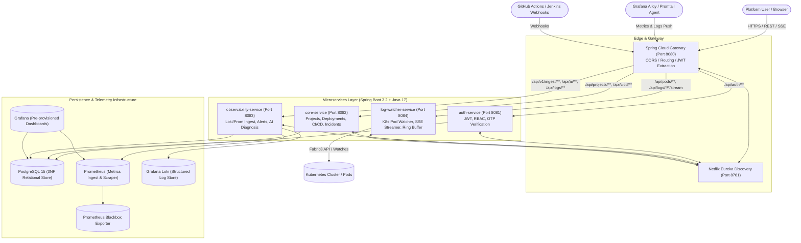
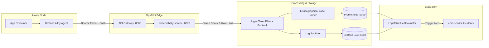
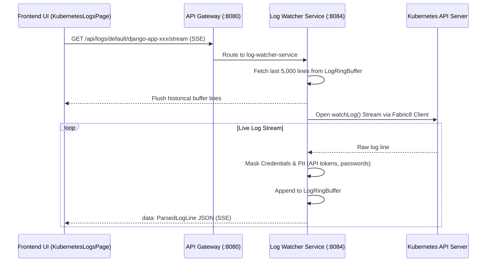

# OpsPilot — Project Summary & Technical Blueprint

> **OpsPilot** is an enterprise-grade, AI-assisted **Internal Developer Platform (IDP)** and **Site Reliability Engineering (SRE)** suite designed to eliminate developer cognitive overload. It unifies microservice project governance, continuous deployment workflows, container orchestration, real-time Kubernetes pod log streaming, push-model host observability, and automated AI root-cause diagnosis into a high-performance web dashboard.

---

## 📑 Table of Contents
1. [Executive Summary & Problem Statement](#1-executive-summary--problem-statement)
2. [High-Level Architecture](#2-high-level-architecture)
3. [Technology Stack](#3-technology-stack)
4. [Backend Microservices Architecture](#4-backend-microservices-architecture)
5. [Frontend Single Page Application (SPA)](#5-frontend-single-page-application-spa)
6. [Core Platform Capabilities](#6-core-platform-capabilities)
7. [Database Schema & Migration History (Flyway V1–V14)](#7-database-schema--migration-history-flyway-v1v14)
8. [API Gateway Routing & REST Matrix](#8-api-gateway-routing--rest-matrix)
9. [Telemetry & Observability Pipeline](#9-telemetry--observability-pipeline)
10. [Kubernetes Log Watcher & Pod Diagnostics](#10-kubernetes-log-watcher--pod-diagnostics)
11. [Project Directory Layout](#11-project-directory-layout)
12. [Local Setup, Execution & Deployment](#12-local-setup-execution--deployment)
13. [Quality Assurance, Testing & Roadmap](#13-quality-assurance-testing--roadmap)

---

## 1. Executive Summary & Problem Statement

### The Problem
Modern cloud-native engineering teams frequently struggle with **tooling fragmentation** and **cognitive fatigue**:
- **Scattered Operations**: Developers must juggle separate consoles for CI/CD (GitHub Actions, Jenkins), infrastructure orchestrators (Kubernetes, Docker), telemetry stores (Prometheus, Loki, Grafana), and incident tracking.
- **Insecure Observability**: Legacy container monitoring solutions frequently mount `/var/run/docker.sock` directly into monitoring containers, introducing severe privilege escalation attack vectors.
- **Incident Diagnosis Delays**: When a pipeline or deployment fails, engineers spend valuable time cross-referencing commit histories, application logs, and cluster metrics manually to find the root cause.
- **Kubernetes Access Barriers**: Developers often lack `kubectl` permissions or cluster network access to inspect crashing pods, debug CrashLoopBackOff states, or tail container logs safely.

### The OpsPilot Solution
OpsPilot addresses these issues by delivering a **single pane of glass** with strict role-based access control (RBAC):
- **Unified Developer Control Plane**: Create projects, configure CI/CD pipeline sources, trigger multi-environment deployments, and inspect build statuses.
- **Zero-Socket Push Monitoring**: Replaced direct daemon sockets with a secure, push-based metrics and log ingestion pipeline protected by SHA-256 hashed API tokens and `bucket4j` rate limiting.
- **Real-Time K8s Log Streaming**: Fabric8-powered streaming engine with Server-Sent Events (SSE), bounded ring buffers, regex credential masking, and automatic CrashLoopBackOff detection.
- **AI-Powered Root-Cause Analysis**: Correlates deployment commits, error log spikes, and infrastructure anomalies using LLMs to provide immediate root-cause explanations and remediation steps.

---

## 2. High-Level Architecture



---

## 3. Technology Stack

### Backend Core
- **Framework**: Spring Boot 3.2.5, Spring Cloud 2023.0.1 (Eureka Discovery, Spring Cloud Gateway)
- **Language / Runtime**: Java 17+ (LTS) / OpenJDK
- **Data Access**: Spring Data JPA / Hibernate, Flyway Database Migrations (V1–V14)
- **Security**: Spring Security 6, JJWT (0.12.5), BCrypt Password Encoder, Google OAuth2 SDK
- **Resilience & Rate Limiting**: `bucket4j` token-bucket rate limiting
- **Kubernetes Client**: Fabric8 Kubernetes Client (`io.fabric8:kubernetes-client:6.13.4`)
- **Build System**: Apache Maven 3.9+ Multi-Module (`backend/pom.xml`)

### Frontend SPA
- **Framework**: React 19 (`react: ^19.2.7`, `react-dom: ^19.2.7`)
- **Language**: TypeScript (`~6.0.2`), Node.js 18+
- **Bundler & Tooling**: Vite (`^8.1.1`), Oxlint (`^1.71.0`)
- **Styling**: Tailwind CSS v4 (`@tailwindcss/vite: ^4.3.3`), Lucide React icons (`lucide-react: ^1.25.0`)
- **State & Data Fetching**: TanStack Query v5 (`@tanstack/react-query: ^5.101.4`), Axios (`^1.19.0`)
- **Routing**: React Router v7 (`react-router-dom: ^7.18.1`)
- **Visualizations**: Recharts (`^3.10.1`), React Grid Layout (`react-grid-layout: ^2.2.4`)
- **Form & Schema Validation**: Zod (`^4.4.3`)

### Infrastructure & Telemetry
- **Database**: PostgreSQL 15 (Alpine)
- **Metrics Store**: Prometheus (`prom/prometheus:latest`) with remote-write receiver enabled
- **Log Store**: Grafana Loki 3.0.0
- **Dashboards**: Grafana (`grafana/grafana:latest`) with pre-provisioned data sources and dashboards
- **Synthetic Monitoring**: Prometheus Blackbox Exporter (`prom/blackbox-exporter:latest`)
- **Orchestration**: Docker Compose (Local Dev), Kubernetes manifests (`k8s/log-watcher/`)

---

## 4. Backend Microservices Architecture

OpsPilot is engineered as a clean, decoupled microservices mesh coordinated via service discovery:

### 1. `service-registry` (Port: 8761)
- Spring Cloud Netflix Eureka Discovery server.
- Provides dynamic service registration and client-side load balancing (`lb://`) for gateway routes.

### 2. `api-gateway` (Port: 8080)
- Single ingress point for all frontend client traffic and external agent ingest traffic.
- Provides CORS handling for `http://localhost:5173`, path rewriting, and route predicates.
- Routes all `/api/auth/**`, `/api/projects/**`, `/api/cicd/**`, `/api/v1/ingest/**`, and `/api/pods/**` to respective downstream instances.

### 3. `auth-service` (Port: 8081)
- Manages user accounts, credentials, and role assignments (`ADMIN`, `DEVELOPER`, `DEVOPS`).
- Issues and validates signed JWT bearer tokens with refresh token rotation.
- Implements two-factor registration verification via **Email OTP** (`JavaMailSender`, SMTP) with configurable expiration, attempt limits, and resend cooldowns.
- Supports Google OAuth2 identity federated login.

### 4. `core-service` (Port: 8082)
- Domain business engine managing **Projects**, **Deployments**, **Environments** (Dev, Staging, Prod), and **Pipeline Sources**.
- Ingests CI/CD webhook payloads from **GitHub Actions** (`workflow_run`, `push`) and **Jenkins**.
- Manages **Incidents**: Automatically opens an incident record when a CI/CD build fails or a critical deployment error occurs.
- Tracks platform audit logs and administrator governance policies.

### 5. `observability-service` (Port: 8083)
- Hosts push-model ingestion controllers for logs and metrics:
  - **Loki Push Controller**: Receives structured container logs via JSON/Protobuf, injects metadata, and forwards to Loki.
  - **Prometheus Push Controller**: Remote-write proxy that lexicographically sorts labels and proxies metrics to Prometheus.
- **Ingest Rate Limiting**: Enforces strict per-token rate limits using `bucket4j`.
- **Dynamic Alert Evaluator**: Background scheduled task (`LogMetricAlertEvaluator`) evaluating CPU thresholds, memory leaks, and error log repetition.
- **AI Root Cause Correlation Engine**: Analyzes incident context, deployment diffs, and timestamp-correlated log lines to produce diagnostic reports.

### 6. `log-watcher-service` (Port: 8084)
- Dedicated microservice for direct Kubernetes cluster diagnostics without exposing `kubectl` credentials to clients.
- Connects to in-cluster or kubeconfig targets via the Fabric8 client.
- Provides **Server-Sent Events (SSE)** log streaming (`GET /api/logs/{namespace}/{pod}/stream`).
- Features a thread-safe **Circular Ring Buffer** (`LogRingBuffer`) keeping the most recent 5,000 log lines per pod.
- Real-time **Credential & Secret Masking** (replaces Bearer tokens, API keys, passwords, and private certificates with `***MASKED***`).
- Evaluates pod restarts, exit codes, and `waiting.reason == 'CrashLoopBackOff'` to surface unhealthy pods immediately.

### 7. `shared-lib`
- Shared Maven library containing common domain entities (`User`, `Project`, `Deployment`, `Incident`, `AlertRule`, `DockerLogSource`), shared DTOs, security filters, JWT validators, and Flyway database migrations (V1–V14).

---

## 5. Frontend Single Page Application (SPA)

The user interface is built on a dark, high-contrast palette (`#060B18` canvas, `#0F1B2E` cards, `#38BDF8` cyan accents, `#A78BFA` AI violet accents) designed for high-density operations.

### Key Pages and Views

| Page Component | Path | Allowed Roles | Description |
|---|---|---|---|
| `LandingPage.tsx` | `/` | Public | Product introduction, value proposition, and feature highlights |
| `Login.tsx` / `Signup.tsx` | `/login`, `/signup` | Public | Authentication with form validation, 3D tilt effects, and Google OAuth |
| `VerifyEmailOTP.tsx` | `/verify-email` | Public | 6-digit OTP email verification with timer and cooldowns |
| `Dashboard.tsx` | `/dashboard` | Authenticated | High-level metrics, active deployments, recent incidents, project summaries |
| `AdminDashboard.tsx` | `/dashboard` | `ADMIN` | System-wide governance, user rosters, cluster stats, and audit trails |
| `Projects.tsx` | `/projects` | `DEVELOPER`, `DEVOPS` | Grid of managed microservices, repo links, and health indicators |
| `ProjectWizard.tsx` | `/projects/new` | `DEVELOPER` | Multi-step wizard to register projects, link Git repositories, and configure environments |
| `ProjectDetail.tsx` | `/projects/:id` | `DEVELOPER`, `DEVOPS` | Deep-dive for an individual project (deployments, integrations, logs, metrics) |
| `Pipelines.tsx` | `/pipelines` | `DEVELOPER`, `DEVOPS` | Real-time CI/CD pipeline runs from GitHub Actions and Jenkins |
| `PipelineDetail.tsx` | `/pipelines/:id` | `DEVELOPER`, `DEVOPS` | Commit SHA, author, step-by-step pipeline output, and logs |
| `DeploymentsPage.tsx` | `/deployments` | `DEVELOPER`, `DEVOPS` | Historical list of deployment versions across Dev, Staging, and Production |
| `KubernetesDashboard.tsx` | `/kubernetes` | `DEVELOPER`, `DEVOPS`, `ADMIN` | Pod health, node resource consumption, restart counts, and status indicators |
| `KubernetesLogsPage.tsx` | `/kubernetes/logs` | `DEVELOPER`, `DEVOPS`, `ADMIN` | Split-view live terminal: real-time SSE pod logs with regex filtering |
| `LogSources.tsx` | `/docker`, `/projects/:id/log-sources` | `DEVELOPER`, `DEVOPS`, `ADMIN` | Docker Push Log Sources dashboard with Grafana Alloy agent script generation |
| `LogManagement.tsx` | `/logs` | `DEVELOPER`, `DEVOPS` | Global structured log explorer with level filtering (INFO, WARN, ERROR) and search |
| `WhiteboxMonitoring.tsx` | `/whitebox` | `DEVOPS` | Internal application metrics (JVM heap, thread count, garbage collection) |
| `BlackboxMonitoring.tsx` | `/blackbox` | `DEVOPS` | External endpoint availability, HTTP latency, and SSL certificate health |
| `IncidentManagement.tsx` | `/incidents` | `DEVELOPER`, `DEVOPS`, `ADMIN` | Automated incident triage, severity escalation, and AI-assisted root cause resolution |
| `UserManagement.tsx` | `/users` | `ADMIN` | Administrator panel to grant roles, activate/deactivate accounts, and review logins |
| `AdminGovernance.tsx` | `/admin` | `ADMIN` | Compliance audit logs, security policies, and system configuration |

---

## 6. Core Platform Capabilities

### 🔐 1. Role-Based Access Control (RBAC)
- **Admin**: Complete system visibility, user lifecycle management, security policy configuration, project governance, and audit review.
- **Developer**: Focuses on day-to-day delivery: creates projects, links GitHub/Jenkins pipelines, triggers deployments, reviews logs, and resolves incidents.
- **DevOps**: Focuses on infrastructure reliability: inspects Kubernetes clusters, manages push agent tokens, configures Prometheus/Blackbox alerts, and monitors JVM/container performance.

### 🔄 2. Push-Model Container & Host Telemetry
To prevent security vulnerabilities associated with exposing the Docker socket:
1. OpsPilot provisions a unique **Log Source** for each host/environment.
2. OpsPilot generates a cryptographically secure token and stores only its **SHA-256 hash**.
3. OpsPilot generates a ready-to-run **Grafana Alloy** configuration snippet.
4. The Alloy agent pushes logs and metrics over HTTPS to `/api/v1/ingest/**`.
5. OpsPilot validates the token, applies `bucket4j` rate limits, sanitizes metadata, sorts Prometheus labels lexicographically, and writes to Loki/Prometheus.

### ☸️ 3. Kubernetes Pod Streaming & Diagnostics
- Zero-CLI access required for developers.
- Direct connection via Fabric8 Watchers to capture pod lifecycle events.
- Live SSE stream with reconnection logic and backpressure protection.
- In-memory ring buffer (up to 5,000 lines) retains crash context even if a pod restarts.
- Immediate detection and visual badge for `CrashLoopBackOff` pods.

### 🤖 4. AI-Powered Root-Cause Analysis
When an alert triggers or a deployment fails:
1. OpsPilot aggregates the recent commit details (SHA, commit message, author).
2. It extracts the timestamp-correlated application error logs preceding the incident.
3. The AI Diagnosis Engine analyzes the data against known failure patterns (database connection pool exhaustion, null pointers, configuration mismatches, memory out-of-bounds).
4. Returns an actionable summary:
   - **Root Cause Summary**: Concise explanation of what failed.
   - **Blast Radius**: Impacted microservices or environments.
   - **Suggested Fix**: Code or configuration changes to resolve the failure.

---

## 7. Database Schema & Migration History (Flyway V1–V14)

OpsPilot enforces strict relational integrity in PostgreSQL 15, managed sequentially through Flyway migrations in `shared-lib`:

```
backend/shared-lib/src/main/resources/db/migration/
├── V1__init_schema.sql                      # Core 3NF tables (users, roles, projects, deployments, pods, logs)
├── V2__add_indexes.sql                      # Performance b-tree indexes on foreign keys & timestamps
├── V3__add_log_sources.sql                  # Initial log sources schema
├── V4__platform_governance.sql              # Audit logging and platform governance settings
├── V5__add_project_ownership_to_logs.sql    # Relates logs directly to project IDs
├── V6__email_verification.sql               # OTP codes, expiry, attempts, and verification flags on users
├── V7__add_incidents.sql                    # Incident management table with pipeline/project relations
├── V8__add_integrations.sql                 # Third-party integrations (Slack, PagerDuty, Webhooks)
├── V9__add_infrastructure_events.sql        # Node and pod lifecycle event auditing
├── V10__add_alert_engine.sql                # Alert rules (CPU, memory, log error frequencies)
├── V11__update_incidents_for_alerts.sql     # Connects alert engine triggers to incident auto-creation
├── V12__add_notification_engine.sql         # User notification preferences and delivery channels
├── V13__add_pipeline_sources.sql            # Webhook configurations for GitHub Actions & Jenkins
└── V14__docker_log_sources.sql              # Token-authenticated push sources for Docker/Alloy agents
```

### Relational Entity Overview
- `users`: ID, name, email (unique), password_hash, is_active, email_verified, otp_code, otp_expires_at, created_at.
- `roles`: Pre-seeded records for `ROLE_ADMIN`, `ROLE_DEVELOPER`, `ROLE_DEVOPS`.
- `user_roles`: Many-to-many relationship mapping users to roles.
- `projects`: Microservice catalog with project name, Git repo URL, owner FK, and status.
- `deployments`: Deployment history with project FK, user FK, version tag, environment (`dev`/`staging`/`prod`), and status.
- `pipeline_sources`: Webhook secret and configuration for GitHub Actions / Jenkins pipelines per project.
- `pipeline_runs`: Ingested CI/CD runs capturing branch, commit SHA, author, status, and duration.
- `incidents`: Automatically or manually opened incident tickets, severity (`LOW`, `MEDIUM`, `HIGH`, `CRITICAL`), status (`OPEN`, `RESOLVED`), and AI diagnosis text.
- `docker_log_sources`: Push-model agents with UUID, project FK, token_hash (SHA-256), token_prefix, status (`WAITING`, `ACTIVE`, `STALE`), and last_seen_at.
- `alert_rules`: Threshold definitions (`HIGH_CPU`, `HIGH_MEMORY`, `REPEATED_ERROR_LOGS`) evaluated against Prometheus/Loki.
- `audit_logs`: Governance tracking recording user actions, timestamps, and target entities.

---

## 8. API Gateway Routing & REST Matrix

All external traffic enters through the **API Gateway** on port `8080`:

| Ingress Path Predicate | Upstream Service | Port | Description |
|---|---|---|---|
| `/api/auth/**`, `/api/v1/auth/**` | `auth-service` | 8081 | Register, login, refresh tokens, OTP email verification, OAuth2 |
| `/api/projects/**`, `/api/v1/projects/**` | `core-service` | 8082 | Project CRUD, settings, and member access |
| `/api/deployments/**`, `/api/v1/deployments/**` | `core-service` | 8082 | Deployment lifecycle, rollback, and environment tracking |
| `/api/cicd/**`, `/api/v1/cicd/**` | `core-service` | 8082 | Webhook receivers for GitHub Actions (`workflow_run`) and Jenkins |
| `/api/incidents/**`, `/api/v1/incidents/**` | `core-service` | 8082 | Incident triage, severity updates, and resolution |
| `/api/admin/**`, `/api/v1/admin/**` | `core-service` | 8082 | System governance, audit logs, and global user management |
| `/api/v1/log-sources/**`, `/api/v1/ingest/**` | `observability-service` | 8083 | Push-model Docker log/metric ingest with SHA-256 token verification |
| `/api/logs/**`, `/api/v1/logs/**` | `observability-service` | 8083 | Structured log search across Loki and database stores |
| `/api/monitoring/**`, `/api/v1/monitoring/**` | `observability-service` | 8083 | Whitebox JVM metrics and Blackbox synthetic endpoint health |
| `/api/ai/**`, `/api/v1/ai/**` | `observability-service` | 8083 | AI root cause diagnosis queries linking logs and commits |
| `/api/notifications/**` | `observability-service` | 8083 | Notification center queries and mark-as-read updates |
| `/api/pods/**`, `/api/v1/pods/**` | `log-watcher-service` | 8084 | Kubernetes pod lists, health states, and CrashLoopBackOff detection |
| `/api/logs/{ns}/{pod}/stream` | `log-watcher-service` | 8084 | Real-time Server-Sent Events (SSE) pod log tailing with masking |
| `/api/health/summary` | `log-watcher-service` | 8084 | Aggregate Kubernetes cluster health summary |

---

## 9. Telemetry & Observability Pipeline

OpsPilot features a dual-telemetry ingestion pipeline:



### Telemetry Highlights
1. **Prometheus Remote-Write Ingestion**: Alloy scrapes container metrics (CPU, RAM, disk, network) and writes them to `/api/v1/ingest/metrics`. The service ensures all metric labels are lexicographically sorted to avoid rejection by Prometheus.
2. **Loki Structured Log Ingestion**: Container stdout/stderr streams are pushed to `/api/v1/ingest/logs`, tagged with `source_id`, `project_id`, and `environment`.
3. **Blackbox Prober**: Periodically polls registered web endpoints (HTTP 200 checks, latency percentiles, TLS certificate expiration dates).
4. **Grafana Dashboards**: Shipped with pre-configured dashboard JSONs for JVM performance, host metrics, and container workloads.

---

## 10. Kubernetes Log Watcher & Pod Diagnostics

Located in `backend/log-watcher-service` and packaged for deployment in `k8s/log-watcher/`:



### Production Manifests (`k8s/log-watcher/`)
- `rbac.yaml`: Least-privilege `ServiceAccount`, `Role`, and `RoleBinding` granting read-only access to `pods`, `pods/log`, and `events`.
- `configmap.yaml`: Sets `WATCH_NAMESPACE`, `LOG_BUFFER_MAX_LINES=5000`, and `LOG_MASKING_ENABLED=true`.
- `deployment.yaml`: Non-root container (UID 10001), 256Mi RAM limit, G1GC tuning, and Actuator liveness/readiness probes.
- `ingress.yaml`: Traefik ingress configuration with buffering disabled (`traefik.ingress.kubernetes.io/buffering: "false"`) to support latency-free SSE streaming.
- `kustomization.yaml`: Single-command Kustomize deployment definition.
- `sample-django-app.yaml`: Ready-to-test workload for CrashLoopBackOff demonstration.

---

## 11. Project Directory Layout

```
D:\OpsPilot
├── .github/workflows/          # GitHub Actions CI/CD workflows
├── backend/                    # Spring Boot 3 multi-module backend
│   ├── api-gateway/            # Spring Cloud Gateway (Port 8080)
│   ├── service-registry/       # Netflix Eureka discovery server (Port 8761)
│   ├── auth-service/           # Authentication, RBAC, OTP, Google OAuth2 (Port 8081)
│   ├── core-service/           # Projects, deployments, CI/CD, incidents (Port 8082)
│   ├── observability-service/  # Push ingest, Loki/Prometheus, alerts, AI (Port 8083)
│   ├── log-watcher-service/    # K8s pod watcher, SSE log streamer, ring buffer (Port 8084)
│   ├── shared-lib/             # Shared entities, DTOs, security, Flyway migrations
│   ├── pom.xml                 # Maven parent POM (Spring Boot 3.2.5, Java 17)
│   └── run.ps1                 # Local microservices startup script
├── frontend/                   # React 19 + TypeScript + Vite SPA
│   ├── src/
│   │   ├── components/         # Reusable UI components (Cards, Tables, Modals, Badges)
│   │   ├── context/            # AuthContext (JWT, session persistence, role routing)
│   │   ├── pages/              # 25+ application pages and dashboards
│   │   ├── services/api.ts     # Axios API layer with automatic token refresh
│   │   └── utils/roles.ts      # Client-side RBAC authorization helpers
│   ├── package.json            # Vite, Tailwind CSS v4, Lucide React, TanStack Query
│   └── vite.config.ts          # Vite build and dev server configuration
├── grafana/                    # Pre-provisioned dashboards and datasources
├── k8s/                        # Production Kubernetes deployment manifests
│   └── log-watcher/            # RBAC, ConfigMap, Deployment, Ingress, Kustomization
├── verification/               # Test evidence, mock scripts, and QA validation reports
├── docker-compose.yml          # Container orchestration (Postgres, Prometheus, Loki, Grafana)
├── prometheus.yml              # Prometheus scrape configs & remote-write receiver
├── loki-config.yml             # Grafana Loki storage & retention configuration
├── blackbox.yml                # Blackbox prober modules (HTTP, TCP, DNS)
└── README.md                   # Getting started and general documentation
```

---

## 12. Local Setup, Execution & Deployment

### Prerequisites
- **Java**: OpenJDK 17 or higher
- **Node.js**: v18.0.0 or higher & npm
- **Docker**: Docker Engine & Docker Compose
- **Kubernetes** *(Optional)*: Minikube, k3s, or Docker Desktop Kubernetes

---

### Option A: Full Docker Compose Stack
To run the database, telemetry tools, and all microservices in containers:

```bash
# From project root
docker-compose up -d --build
```

**Exposed Services:**
- Frontend: `http://localhost:5173`
- API Gateway: `http://localhost:8080`
- Eureka Discovery: `http://localhost:8761`
- Grafana: `http://localhost:3000` (User: `admin`, Pass: `admin`)
- Prometheus: `http://localhost:9090`
- PostgreSQL: `localhost:5432`

---

### Option B: Local Development (Hybrid)
To run dependencies in Docker and microservices on host:

1. **Start Infrastructure Containers**:
   ```bash
   docker-compose up -d postgres prometheus loki grafana blackbox
   ```

2. **Build and Run Backend**:
   ```powershell
   cd backend
   .\mvnw.cmd clean package -DskipTests
   .\run.ps1
   ```
   *Alternatively, launch each microservice module via `./mvnw spring-boot:run`.*

3. **Start Frontend Development Server**:
   ```bash
   cd frontend
   npm install
   npm run dev
   ```
   Access the dashboard at `http://localhost:5173`.

---

### Option C: Kubernetes Log Watcher Deployment
To deploy the log watcher daemon to a live cluster (e.g. k3s / EKS):

```bash
# Deploy RBAC, config, deployment, and service
kubectl apply -k k8s/log-watcher/

# Verify status
kubectl rollout status deployment/opspilot-log-watcher -n default

# Deploy sample test workload
kubectl apply -f k8s/log-watcher/sample-django-app.yaml
```

---

## 13. Quality Assurance, Testing & Roadmap

### Verification & Testing Status
- **Backend Unit & Integration Tests**: Comprehensive JUnit 5 test suites covering token generation, email OTP expiry, rate limiting, and log buffer FIFO ordering:
  ```bash
  cd backend && ./mvnw test
  ```
- **Frontend Code Quality**: Verified with TypeScript type checks (`tsc -b`) and Oxlint:
  ```bash
  cd frontend && npm run build
  ```
- **Security Auditing**:
  - Direct `docker.sock` mount eliminated.
  - Push ingest endpoints protected with `IngestTokenFilter` and SHA-256 tokens.
  - Rate limiting active with `bucket4j`.
  - Sensitive tokens and passwords masked before leaving `log-watcher-service`.

### Current Roadmap & Future Enhancements
1. **WebSocket Notifications**: Upgrade notification delivery from polling to full duplex WebSockets / STOMP.
2. **Helm Charts**: Package the full OpsPilot backend and UI into an official Helm Chart for one-command enterprise deployment.
3. **Multi-Cluster Federation**: Allow `log-watcher-service` to connect across multiple remote Kubernetes clusters via kubeconfig contexts.
4. **LLM Remediation Actions**: Enable the AI Assistant to generate and apply automated pull requests or rollback triggers directly upon incident diagnosis.

---

*OpsPilot — Empowering Engineering Teams with Unified, Intelligent Cloud Operations.*
