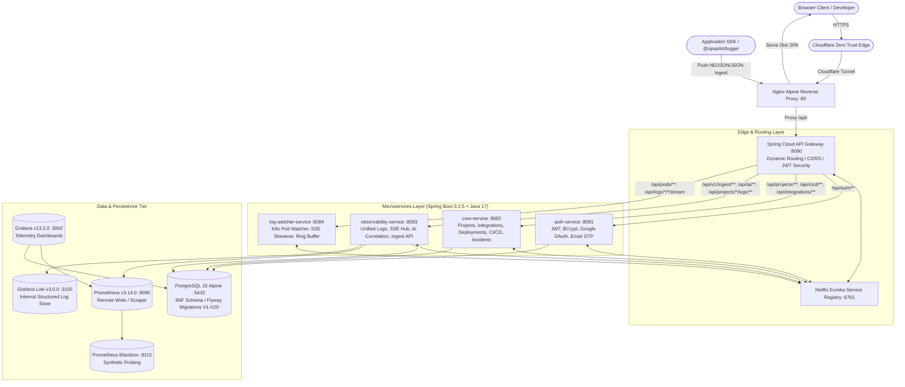
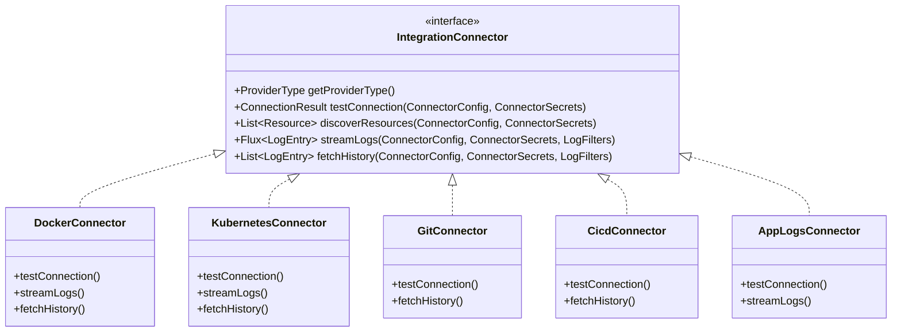
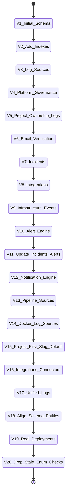
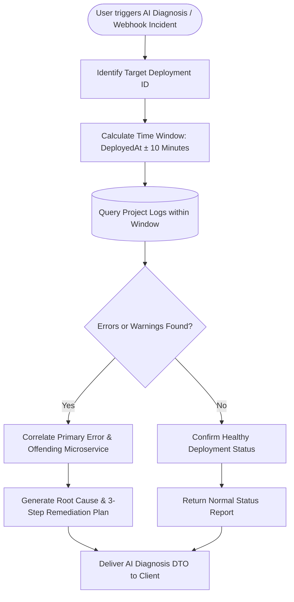

# OpsPilot — Advanced Technical Architecture & System Blueprint

> **OpsPilot** is an enterprise-grade, AI-assisted **Internal Developer Platform (IDP)** and **Site Reliability Engineering (SRE)** workbench. It consolidates project governance, multi-cloud infrastructure integrations, automated deployment tracking, real-time Kubernetes/Docker log streaming via Server-Sent Events (SSE), synthetic blackbox probes, and AI-powered root-cause correlation into a single, high-performance web dashboard.

---

## 📑 Table of Contents

1. [Executive Summary & Problem Statement](#1-executive-summary--problem-statement)
2. [High-Level System Architecture](#2-high-level-system-architecture)
3. [Technology Stack & Frameworks](#3-technology-stack--frameworks)
4. [Backend Microservices Breakdown](#4-backend-microservices-breakdown)
   - [API Gateway (`api-gateway`)](#41-api-gateway-opspilot-api-gateway)
   - [Service Discovery (`service-registry`)](#42-service-discovery-opspilot-service-registry)
   - [Authentication & Identity (`auth-service`)](#43-authentication--identity-opspilot-auth-service)
   - [Core Domain & Integrations (`core-service`)](#44-core-domain--integrations-opspilot-core-service)
   - [Unified Observability & AI (`observability-service`)](#45-unified-observability--ai-opspilot-observability-service)
   - [Kubernetes Log Streamer (`log-watcher-service`)](#46-kubernetes-log-streamer-opspilot-log-watcher-service)
   - [Shared Library (`shared-lib`)](#47-shared-library-comopspilotshared-lib)
5. [Frontend Single-Page Application (SPA)](#5-frontend-single-page-application-spa)
   - [Design Tokens & Locked Dark Theme](#51-design-tokens--locked-dark-theme)
   - [Project-First UX Navigation & Routing](#52-project-first-ux-navigation--routing)
   - [Real-Time Virtualized SSE Log Engine](#53-real-time-virtualized-sse-log-engine)
   - [Role-Based Access Control (RBAC) in UI](#54-role-based-access-control-rbac-in-ui)
6. [Multi-Provider Connector Ecosystem](#6-multi-provider-connector-ecosystem)
7. [Database Schema & Flyway Migration Journey (V1–V20)](#7-database-schema--flyway-migration-journey-v1v20)
8. [Telemetry, Monitoring & Logging Infrastructure](#8-telemetry-monitoring--logging-infrastructure)
9. [Security, Cryptography & Compliance](#9-security-cryptography--compliance)
10. [AI-Assisted Root Cause Diagnosis Engine](#10-ai-assisted-root-cause-diagnosis-engine)
11. [Developer SDK (`@opspilot/logger`)](#11-developer-sdk-opspilotlogger)
12. [Quality Assurance, Automated Testing & Verification](#12-quality-assurance-automated-testing--verification)
13. [Production Deployment, Ingress & Operations Runbook](#13-production-deployment-ingress--operations-runbook)

---

## 1. Executive Summary & Problem Statement

### 1.1 The Operational Challenge
In modern cloud-native software engineering, teams encounter persistent **tooling fragmentation** and **cognitive overload**:
- **Scattered Operations**: Developers oscillate between GitHub/GitLab, Jenkins, Kubernetes CLI (`kubectl`), Docker engines, AWS/Vercel consoles, Prometheus, Grafana, and Loki.
- **Insecure Observability Defaults**: Many container monitoring tools mount `/var/run/docker.sock` directly into containers, granting root-equivalent host access and creating dangerous privilege escalation vectors.
- **Context-Switching During Incidents**: When a production deployment fails, operators manually cross-reference git commit hashes, deployment timestamps, multi-container logs, and Prometheus spike graphs to deduce the failure cause.
- **Opaque Access Control**: Granting developers direct cloud console or `kubectl` credentials risks credential leakage or accidental destructive operations.

### 1.2 The OpsPilot Solution
OpsPilot solves these hurdles by providing a secure, centralized control plane:
1. **Single Pane of Glass**: Governs projects, deployments, infrastructure connectors, live log streams, and synthetic health probes in one unified React 18 interface.
2. **Zero-Socket Architecture**: Eliminates raw Docker socket mounts in favor of secure, token-authenticated push telemetry and remote API connectors.
3. **Project-First Organization**: Every log line, metric, deployment, incident, and integration is scoped directly to a specific project and environment (`dev`, `staging`, `prod`).
4. **Real-Time Streaming Engine**: Implements reactive Server-Sent Events (SSE) log pipelines backed by bounded circular ring buffers with regex-based credential masking.
5. **AI Root-Cause Diagnosis**: Heuristically correlates deployment boundaries with log error distributions and infrastructure events to explain failures and prescribe actionable remediation steps.

---

## 2. High-Level System Architecture

OpsPilot utilizes a decoupled, resilient microservices architecture orchestrated via Docker Compose and discoverable through Netflix Eureka.



---

## 3. Technology Stack & Frameworks

| Domain | Technology / Library | Version | Description & Role |
|---|---|---|---|
| **Backend Framework** | [Spring Boot](file:///D:/OpsPilot/backend/pom.xml) | `3.2.5` | Modern Java microservice framework with Jakarta EE 10 |
| **Java Runtime** | OpenJDK | `17` / `21` | LTS Java runtime environment |
| **Cloud Routing** | Spring Cloud Gateway | `2023.0.1` | Non-blocking reactive API Gateway with Netty |
| **Service Discovery**| Spring Cloud Netflix Eureka | `2023.0.1` | Dynamic microservice registry and health heartbeat |
| **Security & Auth** | Spring Security 6 + JJWT | `0.12.5` | Stateless JWT tokens, BCrypt password hashing, OTP verification |
| **Database & ORM** | PostgreSQL + Spring Data JPA / Hibernate | `15` / `6.4` | Relational 3NF data store, strict validation |
| **Database Migrations**| Flyway Core | `10.x` | Version-controlled schema migrations (`V1` through `V20`) |
| **Reactive Streams** | Project Reactor (`Flux`, `Mono`) | `3.6.x` | Asynchronous backpressure-managed log event streams |
| **Kubernetes Client**| Official Kubernetes Java Client / Fabric8 | `19.0.0` | In-cluster & loopback pod watches, log streaming |
| **Frontend Framework**| [React](file:///D:/OpsPilot/frontend/package.json) | `18.3.1` | Declarative component UI library |
| **Language & Build** | TypeScript + Vite | `5.5` / `5.4` | Strictly typed frontend with sub-second HMR and optimized chunking |
| **UI Styling** | Tailwind CSS + Lucide React | `3.4` / `0.344` | High-contrast dark theme and comprehensive icon set |
| **State & Data Fetch**| TanStack React Query | `5.28.4` | Asynchronous server state caching, polling, and deduplication |
| **Third-Party SSO** | `@react-oauth/google` | `0.12.1` | Google OAuth 2.0 One Tap & Popup authentication |
| **Telemetry & Metrics**| Prometheus, Loki, Grafana, Blackbox | `v3.14` / `v3.0` / `v13.2` | Metrics collection, log aggregation, visualization, probing |
| **Reverse Proxy** | Nginx Alpine | `1.25+` | HTTP reverse proxy, static asset delivery, SSE chunk forwarding |
| **Tunneling** | Cloudflare Zero Trust Tunnel | `latest` | Secure ingress to `https://opspilot.jestin16.dev` without open inbound ports |

---

## 4. Backend Microservices Breakdown

### 4.1 API Gateway (`opspilot-api-gateway`)
- **Port**: `8080`
- **Class**: [`ApiGatewayApplication`](file:///D:/OpsPilot/backend/api-gateway/src/main/java/com/opspilot/ApiGatewayApplication.java)
- **Role**: Single entry point for all client and webhook traffic.
- **Capabilities**:
  - Dynamically routes incoming HTTP requests to microservices using Eureka service IDs (`lb://auth-service`, `lb://core-service`, `lb://observability-service`, `lb://log-watcher-service`).
  - Implements global CORS configurations supporting localhost, internal Docker hosts, and production domains (`https://opspilot.jestin16.dev`).
  - Disables buffering on Server-Sent Events (SSE) routes to enable instantaneous chunk streaming.
  - Integrates Spring Boot Actuator with readiness probes backing container health checks.

### 4.2 Service Discovery (`opspilot-service-registry`)
- **Port**: `8761`
- **Class**: `ServiceRegistryApplication`
- **Role**: Netflix Eureka Service Registry.
- **Capabilities**:
  - Maintains heartbeats from all microservices every 30 seconds.
  - Enables zero-configuration service discovery and dynamic client-side load balancing via Spring Cloud Gateway.

### 4.3 Authentication & Identity (`opspilot-auth-service`)
- **Port**: `8081`
- **Controller**: [`AuthController`](file:///D:/OpsPilot/backend/auth-service/src/main/java/com/opspilot/controller/AuthController.java)
- **Service**: [`AuthService`](file:///D:/OpsPilot/backend/auth-service/src/main/java/com/opspilot/service/AuthService.java)
- **Role**: Authentication, authorization, and RBAC policy enforcement.
- **Capabilities**:
  - **Email & Password Authentication**: Validates user credentials with BCrypt encryption.
  - **Email OTP Verification**: Delivers a 6-digit numeric OTP via [`EmailService`](file:///D:/OpsPilot/backend/auth-service/src/main/java/com/opspilot/service/EmailService.java) (backed by `JavaMailSender` over SMTP). Implements a 5-minute expiration window, 5-attempt brute-force limit, and 60-second resend cooldown.
  - **Google OAuth 2.0 SSO**: Exposes `POST /api/v1/auth/google-login`. Verifies Google signed ID tokens via Google's token endpoint (`https://oauth2.googleapis.com/tokeninfo`), creates or resolves the user in Postgres, and returns an OpsPilot JWT.
  - **Stateless JWT Issuance**: Issues signed JWTs (HMAC-SHA256 with 256+ bit key) with customizable expiration (15-minute access token, 7-day refresh token).
  - **Role-Based Access Control**: Assigns explicit platform roles (`ADMIN`, `DEVOPS`, `DEVELOPER`) with strict endpoint guard authorization.

### 4.4 Core Domain & Integrations (`opspilot-core-service`)
- **Port**: `8082`
- **Controllers**:
  - [`ProjectController`](file:///D:/OpsPilot/backend/core-service/src/main/java/com/opspilot/controller/ProjectController.java): Project CRUD, slug generation, environment scoping (`dev`, `staging`, `prod`).
  - [`IntegrationController`](file:///D:/OpsPilot/backend/core-service/src/main/java/com/opspilot/controller/IntegrationController.java): Manages integrations, connection testing, resource discovery.
  - [`DeploymentController`](file:///D:/OpsPilot/backend/core-service/src/main/java/com/opspilot/controller/DeploymentController.java): Records real deployments from Manual, GitHub, or CI pipelines.
  - [`CiCdController`](file:///D:/OpsPilot/backend/core-service/src/main/java/com/opspilot/controller/CiCdController.java): Receives GitHub Actions webhooks and manages pipeline runs.
  - [`IncidentController`](file:///D:/OpsPilot/backend/core-service/src/main/java/com/opspilot/controller/IncidentController.java): Handles incident lifecycles and correlated alerts.
  - [`UserController`](file:///D:/OpsPilot/backend/core-service/src/main/java/com/opspilot/controller/UserController.java) & [`AdminGovernanceController`](file:///D:/OpsPilot/backend/core-service/src/main/java/com/opspilot/controller/AdminGovernanceController.java): System auditing, user management, and platform governance.
- **Provider Adapters**:
  - [`DockerIntegrationAdapter`](file:///D:/OpsPilot/backend/core-service/src/main/java/com/opspilot/integration/adapters/DockerIntegrationAdapter.java): Docker Engine TCP API client.
  - [`KubernetesIntegrationAdapter`](file:///D:/OpsPilot/backend/core-service/src/main/java/com/opspilot/integration/adapters/KubernetesIntegrationAdapter.java): Kubernetes API client via in-cluster service account or host loopback.
  - [`GitHubIntegrationAdapter`](file:///D:/OpsPilot/backend/core-service/src/main/java/com/opspilot/integration/adapters/GitHubIntegrationAdapter.java): GitHub REST API & webhook parser (`push`, `pull_request`, `workflow_run`, `deployment`).
  - [`AwsIntegrationAdapter`](file:///D:/OpsPilot/backend/core-service/src/main/java/com/opspilot/integration/adapters/AwsIntegrationAdapter.java): AWS SDK v2 (EC2, ECS, EKS, CloudWatch, STS).
  - [`OracleCloudIntegrationAdapter`](file:///D:/OpsPilot/backend/core-service/src/main/java/com/opspilot/integration/adapters/OracleCloudIntegrationAdapter.java): OCI resource discovery and telemetry.
  - [`VercelIntegrationAdapter`](file:///D:/OpsPilot/backend/core-service/src/main/java/com/opspilot/integration/adapters/VercelIntegrationAdapter.java): Vercel Projects, Deployments, and Build logs.

### 4.5 Unified Observability & AI (`opspilot-observability-service`)
- **Port**: `8083`
- **Controllers & Services**:
  - [`ProjectLogController`](file:///D:/OpsPilot/backend/observability-service/src/main/java/com/opspilot/projectlogs/ProjectLogController.java): Serves filtered historical log queries and live Server-Sent Events (`/api/v1/projects/{id}/logs/stream`).
  - [`ConnectorRunner`](file:///D:/OpsPilot/backend/observability-service/src/main/java/com/opspilot/projectlogs/ConnectorRunner.java): Scheduled background engine that actively reconciles `CONNECTED` pull-based integrations, subscribes via Reactor `Flux`, and funnels logs into the central store.
  - [`ProjectIngestController`](file:///D:/OpsPilot/backend/observability-service/src/test/java/com/opspilot/projectlogs/ProjectIngestControllerTest.java): Push endpoint (`POST /api/v1/ingest/{projectId}`) supporting JSON, NDJSON, array payloads, and plain text.
  - [`AiAssistantService`](file:///D:/OpsPilot/backend/observability-service/src/main/java/com/opspilot/service/AiAssistantService.java): AI root-cause correlation engine analyzing error logs around deployment time windows.
  - [`BlackboxService`](file:///D:/OpsPilot/backend/observability-service/src/main/java/com/opspilot/service/BlackboxService.java): Synthetic HTTP/TCP probing querying Prometheus Blackbox Exporter (`probe_success`, `probe_duration_seconds`, `probe_http_status_code`).
  - [`AlertEvaluator`](file:///D:/OpsPilot/backend/shared-lib/src/main/java/com/opspilot/alerting/AlertEvaluator.java): Evaluates log frequency and metric threshold alert rules.

### 4.6 Kubernetes Log Streamer (`opspilot-log-watcher-service`)
- **Port**: `8084` (Host mapped to `8085` in dev)
- **Class**: [`KubernetesPodWatcher`](file:///D:/OpsPilot/backend/log-watcher-service/src/main/java/com/opspilot/logwatcher/service/KubernetesPodWatcher.java)
- **Role**: Dedicated streaming microservice communicating with Kubernetes clusters.
- **Capabilities**:
  - Maintains persistent watches via official Kubernetes OpenAPI client (`Watch<V1Pod>`).
  - Emits real-time pod logs using [`LogRingBuffer`](file:///D:/OpsPilot/backend/log-watcher-service/src/main/java/com/opspilot/logwatcher/service/LogRingBuffer.java), a bounded in-memory circular buffer with $O(1)$ eviction and per-line character safeguards (8,192 characters max).
  - Automatically detects container crash loops (`CrashLoopBackOff`, error exit codes, high restart counts) and surfaces them in [`ClusterHealthSummaryDto`](file:///D:/OpsPilot/backend/log-watcher-service/src/main/java/com/opspilot/logwatcher/model/ClusterHealthSummaryDto.java).
  - Masks credentials dynamically on the stream using [`CredentialMasker`](file:///D:/OpsPilot/backend/shared-lib/src/main/java/com/opspilot/security/credential/CredentialMasker.java).

### 4.7 Shared Library (`com.opspilot:shared-lib`)
- Reusable cross-cutting dependency imported across microservices:
  - **Entity Domain Models**: `Project`, `Deployment`, `Integration`, `LogEntity`, `Incident`, `AlertRule`, `User`, `Role`, `PipelineRun`, `InfrastructureEvent`.
  - **Security Filters**: [`JwtAuthenticationFilter`](file:///D:/OpsPilot/backend/shared-lib/src/main/java/com/opspilot/config/JwtAuthenticationFilter.java), [`IngestTokenFilter`](file:///D:/OpsPilot/backend/shared-lib/src/main/java/com/opspilot/config/IngestTokenFilter.java), [`RateLimitingFilter`](file:///D:/OpsPilot/backend/shared-lib/src/main/java/com/opspilot/config/RateLimitingFilter.java).
  - **Converters**: [`SecretEncryptionConverter`](file:///D:/OpsPilot/backend/shared-lib/src/main/java/com/opspilot/converter/SecretEncryptionConverter.java) (AES-256-GCM encryption with `enc:v1:` prefix).
  - **Base Connector Abstractions**: `IntegrationConnector`, `ConnectorRegistry`, `Levels`, `LogFilters`.

---

## 5. Frontend Single-Page Application (SPA)

The frontend is built with React 18, Vite, TypeScript, and Tailwind CSS. It is structured around the **Project-First** philosophy.

```
frontend/src/
├── components/          # Reusable UI cards, tables, modals, badges, layout
│   ├── AlertProvider.tsx
│   ├── ConfirmProvider.tsx
│   ├── Layout.tsx       # Main app layout with Topbar, Sidebar, ProjectSwitcher
│   └── ProjectSwitcher.tsx
├── context/             # Global React Contexts
│   ├── AuthContext.tsx & AuthProvider.tsx
│   └── ProjectContext.tsx & ProjectProvider.tsx
├── hooks/               # Custom React hooks (useLogStream, useMetrics, etc.)
├── lib/                 # Core utilities & testable helpers
│   ├── api.ts           # Axios client with JWT interceptor & refresh loop
│   ├── deployments.ts   # Deployment status calculation and duration formatters
│   ├── integrationTypes.ts # Form definitions for multi-provider configurations
│   ├── logBuffer.ts     # Bounded in-memory virtual log buffer (5,000 items)
│   └── sse.ts           # Streaming fetch reader & Last-Event-ID resume parser
├── pages/               # 30+ Route components (Dashboard, Logs, Integrations, etc.)
└── utils/               # Roles (`canAccessRole`, `isAdmin`) and date helpers
```

### 5.1 Design Tokens & Locked Dark Theme
OpsPilot enforces a high-contrast dark theme optimized for SRE and DevOps workflows:

| Token Name | Hex Code | Visual Application |
|---|---|---|
| **Main Background** | `#060B18` | Deep space base background |
| **Card Background** | `#0F1B2E` | Elevated component cards, panels, and modals |
| **Panel Secondary** | `#13233B` | Input fields, active dropdowns, table headers |
| **Borders** | `#1E2D45` | Subtle dividers and structural borders |
| **Primary Accent** | `#38BDF8` | Cyan accent for buttons, active links, primary metrics |
| **AI Accent** | `#A78BFA` | Violet accent for AI Assistant cards, badges, and triggers |
| **Warning Accent** | `#F59E0B` | Amber alert badges, incident flags |
| **Success Accent** | `#10B981` | Emerald badges for active integrations, healthy pods |
| **Danger Accent** | `#EF4444` | Red badges for failed builds, crashing pods |
| **Primary Text** | `#F8FAFC` | High-contrast headings and active data values |
| **Muted Text** | `#94A3B8` | Subtitles, metadata, and placeholder text |

### 5.2 Project-First UX Navigation & Routing
- In the top-left sidebar, the [`ProjectSwitcher`](file:///D:/OpsPilot/frontend/src/components/ProjectSwitcher.tsx) allows users to select an active project.
- Once selected, navigation links (`/logs`, `/deployments`, `/integrations`, `/monitoring`, `/incidents`) automatically scope their views to the active project context.
- If no project is selected, the system gracefully displays cross-project aggregate dashboards with a prominent option to view all resources.

### 5.3 Real-Time Virtualized SSE Log Engine
Live logs are displayed with zero latency using a custom streaming engine implemented in [`frontend/src/lib/sse.ts`](file:///D:/OpsPilot/frontend/src/lib/sse.ts) and [`frontend/src/lib/logBuffer.ts`](file:///D:/OpsPilot/frontend/src/lib/logBuffer.ts):
- **Fetch ReadableStream**: Instead of the browser's native `EventSource` (which cannot attach HTTP `Authorization: Bearer` headers), OpsPilot uses `window.fetch()` with a `ReadableStreamDefaultReader` and `TextDecoder`.
- **Automatic Reconnection & Resumption**: Parses incoming server `id:` lines. Upon network disconnection, reconnects with exponential backoff and passes `Last-Event-ID` to replay any missed log records.
- **Bounded Buffer & Virtualization**: The frontend buffer is capped at 5,000 lines to prevent DOM node bloat and browser memory leaks. A virtualized scroll container renders only visible lines.
- **Interactive Controls**: Auto-scroll toggling, pause/resume, level filters (`DEBUG`, `INFO`, `WARN`, `ERROR`), and regex text searching.

### 5.4 Role-Based Access Control (RBAC) in UI
Route protection is enforced using custom wrappers:
- `ProtectedRoute`: Ensures the user holds an active JWT session.
- `RoleRoute`: Validates user role against allowed role arrays (e.g. `['DEVELOPER', 'DEVOPS']`).
- `AdminRoute`: Restricts system governance (`/admin`, `/users`, `/admin/projects`) strictly to `ADMIN` users.

---

## 6. Multi-Provider Connector Ecosystem

OpsPilot provides a unified connector abstraction ([`IntegrationConnector`](file:///D:/OpsPilot/backend/shared-lib/src/main/java/com/opspilot/connector/IntegrationConnector.java)) in `shared-lib`. Each integration supports connection testing, dynamic resource discovery, and historical/live log streaming:



### Connector Matrix

| Provider | Ingest / Read Mechanism | Configuration Parameters | Secrets Handled (Vault Encrypted) | Capabilities |
|---|---|---|---|---|
| **Docker** | Docker Engine HTTP API over TCP | `host`, `containers` | `caCert` | Container discovery, live logs, status monitoring |
| **Kubernetes** | Kubernetes API / In-cluster SA | `apiServer`, `namespace`, `podName`, `labelSelector` | `token`, `caCert` | Pod discovery, CrashLoopBackOff detection, SSE log tailing |
| **Git (`GITHUB`)** | GitHub REST API + Webhooks | `repo`, `apiBaseUrl`, `pollSeconds` | `token`, `webhookSecret` | Commits, PRs, workflow runs, deployment webhooks |
| **CI/CD** | GitHub Actions / Jenkins API | `baseUrl`, `job`, `repo` | `token`, `username`, `apiToken` | Run history, step logs, build state tracking |
| **App Logs** | Push REST Ingest / Webhook | `app` | Push Ingest Token (`opl_...`) | Multi-format log ingestion (JSON, NDJSON, Text) |
| **AWS** | AWS SDK v2 | `region` | `accessKey`, `secretKey` | EC2, ECS, EKS discovery, CloudWatch logs & metrics |
| **Vercel** | Vercel REST API | `teamId` (optional) | `token` | Project discovery, deployment build logs, events |
| **Oracle Cloud** | OCI Java SDK | `tenancyOcid`, `region`, `compartmentId` | `privateKey`, `fingerprint` | Compute instances, OCI Logging |

---

## 7. Database Schema & Flyway Migration Journey (V1–V20)

OpsPilot enforces strict Third Normal Form (3NF) relational integrity in PostgreSQL. All schema changes are tracked and executed via Flyway migrations located in [`backend/shared-lib/src/main/resources/db/migration`](file:///D:/OpsPilot/backend/shared-lib/src/main/resources/db/migration):



### Migration History Breakdown

1. **`V1__init_schema.sql`**: Initial 3NF tables: `users`, `roles`, `user_roles`, `projects`, `deployments`, `containers`, `pods`, `logs`, `notifications`, `pipeline_runs`, `audit_logs`.
2. **`V2__add_indexes.sql`**: High-performance composite indexes on `logs(source_service, timestamp)`, `deployments(project_id, deployed_at)`.
3. **`V3__add_log_sources.sql`**: Push monitoring log sources with API token hashing.
4. **`V4__platform_governance.sql`**: Platform governance tables: `platform_settings` and `platform_integrations`.
5. **`V5__add_project_ownership_to_logs.sql`**: Direct foreign key relation between `logs` and `projects`.
6. **`V6__email_verification.sql`**: Table `email_verification_otps` with TTL, attempts count, and resend timestamps.
7. **`V7__add_incidents.sql`**: Incident management table (`incidents`) tracking severity (`CRITICAL`, `HIGH`, `MEDIUM`, `LOW`) and resolution workflows.
8. **`V8__add_integrations.sql`**: Multi-cloud provider integration definitions (`integrations`, `resources`).
9. **`V9__add_infrastructure_events.sql`**: Infrastructure event logging (`infrastructure_events`).
10. **`V10__add_alert_engine.sql`**: Alert rules (`alert_rules`) and active alerts (`alerts`).
11. **`V11__update_incidents_for_alerts.sql`**: Correlates alerts directly to triggered incident tickets.
12. **`V12__add_notification_engine.sql`**: Notification policies and multi-channel delivery audit (`notification_deliveries`).
13. **`V13__add_pipeline_sources.sql`**: Webhook receivers and secrets for external CI pipelines (`pipeline_sources`).
14. **`V14__docker_log_sources.sql`**: Specialized Docker push configuration parameters.
15. **`V15__project_first_slug_environment_default.sql`**: Introduces URL-safe project `slug` and `environment` (`dev`, `staging`, `prod`). Automatically migrates legacy orphan records into a created **Default Project**.
16. **`V16__integrations_connectors.sql`**: Connector credential references, ingest token prefix, and unique SHA-256 ingest token index (`uq_integrations_ingest_token_hash`).
17. **`V17__unified_logs.sql`**: Unifies multi-provider logs with `integration_id`, `source_type`, and flexible JSON `metadata`. Creates composite indexes: `idx_logs_project_integration_ts` and `idx_logs_project_level_ts`.
18. **`V18__align_schema_with_entities.sql`**: Enforces strict synchronization between Hibernate JPA entities and Postgres columns; baselines legacy installations.
19. **`V19__real_deployments.sql`**: Shifts from simulated deployments to real deployment tracking (`source` MANUAL or GITHUB, `external_id`, `url`, `actor`). Labels legacy simulated records as `SIMULATED`.
20. **`V20__drop_stale_enum_checks.sql`**: Drops rigid Hibernate-generated enum CHECK constraints on `integrations`, `resources`, and `infrastructure_events` to enable flexible provider categories.

---

## 8. Telemetry, Monitoring & Logging Infrastructure

OpsPilot features a zero-trust, push-and-pull telemetry architecture:

```
[Target Hosts / Services / Containers]
           │
           ├── Push Logs (JSON/NDJSON) ──► POST /api/v1/ingest/{projectId} (OpsPilot Ingest API)
           ├── Push Deployments ─────────► POST /api/v1/ingest/{projectId}/deployments
           └── Synthetic HTTP Probes ────► OpsPilot Blackbox Exporter (:9115)
                                                      │
                                                      ▼
                                       ┌─────────────────────────────┐
                                       │ opspilot-observability-svc  │
                                       └──────────────┬──────────────┘
                                                      │
                       ┌──────────────────────────────┼──────────────────────────────┐
                       ▼                              ▼                              ▼
             ┌──────────────────┐           ┌──────────────────┐           ┌──────────────────┐
             │ PostgreSQL 15    │           │ Prometheus v3.14 │           │ Loki v3.0        │
             │ Historical Logs  │           │ Actuator/Host    │           │ Push Log Store   │
             │ & Incidents      │           │ System Metrics   │           │ (Internal Only)  │
             └─────────┬────────┘           └─────────┬────────┘           └──────────────────┘
                       │                              │
                       └──────────────┬───────────────┘
                                      ▼
                            ┌───────────────────┐
                            │ Grafana v13.2     │
                            │ Pre-provisioned   │
                            │ Dashboards (:3000)│
                            └───────────────────┘
```

- **Prometheus v3.14.0**: Scrapes Spring Boot Actuator `/actuator/prometheus` endpoints and receives remote write metrics.
- **Grafana v13.2.0**: Auto-provisioned with Postgres and Prometheus datasources. Pre-configured dashboards display JVM memory, GC pauses, gateway request latencies, and container metrics.
- **Grafana Loki v3.0.0**: Used as an internal, secure log store. Port 3100 is intentionally kept internal; all external agents push logs through the token-authenticated OpsPilot Ingest API.
- **Prometheus Blackbox Exporter v0.28.0**: Synthetic probing tool that verifies HTTP endpoints, TLS certificates, and TCP latency against public or internal endpoints.

---

## 9. Security, Cryptography & Compliance

OpsPilot is engineered around defensive, zero-trust security principles:

### 9.1 Zero-Socket Container Security
Early monitoring prototypes relied on mounting `/var/run/docker.sock` into containers. OpsPilot eliminates this attack surface entirely:
- No service mounts Docker daemon sockets.
- Docker telemetry is retrieved either via TLS-secured Docker TCP endpoints with CA certificate validation or pushed directly by applications using the OpsPilot SDK.

### 9.2 Credentials Vault & At-Rest Encryption
Integration secrets (GitHub personal access tokens, AWS secret keys, Kubernetes bearer tokens, Vercel tokens) are encrypted before writing to PostgreSQL:
- **Algorithm**: AES-256-GCM authenticated encryption with a 12-byte random Initialization Vector (IV) and a 128-bit authentication tag.
- **Storage Format**: `enc:v1:` + Base64(IV + Ciphertext).
- **Key Enforcement**: Derived via SHA-256 from the mandatory `OPSPILOT_ENCRYPTION_KEY` environment variable. Microservices refuse to boot if this key is missing.
- **Zero-Secret API Responses**: DTOs (`IntegrationResponse`) strip all secret fields. Plaintext secrets are never returned in any REST endpoint.

### 9.3 Ingest Token Security
Applications pushing logs use per-integration ingest tokens:
- **Format**: `opl_` prefix followed by 32 cryptographically secure random bytes (Base64 URL-safe).
- **Storage**: Raw tokens are **never** stored in the database. Only their SHA-256 hex digest is persisted.
- **Verification**: Incoming tokens are hashed and compared against stored hashes using `MessageDigest.isEqual` (constant-time comparison to prevent timing attacks).
- **Display**: The UI only exposes a safe display prefix (e.g. `opl_AbCd1234...`).

### 9.4 Credential Masking in Telemetry
All streamed and persisted logs pass through [`CredentialMasker.java`](file:///D:/OpsPilot/backend/shared-lib/src/main/java/com/opspilot/security/credential/CredentialMasker.java), which applies regular expressions matching passwords, bearer tokens, AWS keys, and authorization headers, replacing them with `********`.

---

## 10. AI-Assisted Root Cause Diagnosis Engine

The AI assistant ([`AiAssistantService`](file:///D:/OpsPilot/backend/observability-service/src/main/java/com/opspilot/service/AiAssistantService.java)) provides automated incident diagnosis:



### How It Works:
1. **Deployment Context Resolution**: Given a deployment ID (or auto-resolving the latest visible deployment for the project), it queries the exact deployment timestamp.
2. **Time-Bounded Log Window**: Restricts log correlation to $\pm 10$ minutes around the deployment event.
3. **Database-Level Filtering**: Queries the project's error and warning logs directly in PostgreSQL, capped at 50 critical entries to ensure predictable latency.
4. **Diagnosis Generation**:
   - Synthesizes the primary root-cause error, identifying the culpable service or integration.
   - Formulates actionable, prescriptive remediation steps (e.g., container memory limit increases, rollback recommendations, environment variable reviews).

---

## 11. Developer SDK (`@opspilot/logger`)

Located in [`sdks/opspilot-node`](file:///D:/OpsPilot/sdks/opspilot-node), the official Node.js SDK allows any service to push logs into OpsPilot with zero configuration:

```javascript
const { initOpsPilot, flushLogs } = require('opspilot-logger');

// Initialize SDK early in application startup
initOpsPilot({
  webhookUrl: 'https://opspilot.jestin16.dev/api/v1/ingest/webhook/2',
  sourceService: 'orders-api',
  batchSize: 20,         // Default: 10
  flushIntervalMs: 3000  // Default: 5000 ms
});

// Standard console output is automatically captured, formatted, and shipped
console.log("Processing order #94821");
console.warn("Inventory low for item #120");
console.error("Payment gateway timed out!");

// In serverless environments (AWS Lambda, Vercel Functions):
await flushLogs();
```

---

## 12. Quality Assurance, Automated Testing & Verification

OpsPilot maintains an extensive, multi-tier testing strategy across unit, integration, and end-to-end browser environments.

### 12.1 Backend Unit & Integration Tests (JUnit 5)
Over 60 test classes cover all microservices:
- **Security & Crypto**: `SecretEncryptionTest`, `IngestTokenServiceTest`, `RateLimitingFilterTest`, `CredentialMaskerTest`.
- **Connectors**: `DockerConnectorTest`, `KubernetesConnectorTest`, `GitAndCicdConnectorTest`, `ConnectorRunnerAndStreamTest`.
- **Adapters**: `AwsIntegrationAdapterTest`, `DockerIntegrationAdapterTest`, `GitHubIntegrationAdapterTest`, `KubernetesIntegrationAdapterTest`, `OracleCloudIntegrationAdapterTest`, `VercelIntegrationAdapterTest`.
- **Log Watcher**: `LogRingBufferTest`, `LogParserTest`, `ExponentialBackoffTest`, `HealthSummaryTest`.

### 12.2 Frontend Unit Tests (Vitest)
Located in [`frontend/src/lib`](file:///D:/OpsPilot/frontend/src/lib) and [`frontend/src/pages`](file:///D:/OpsPilot/frontend/src/pages):
- `sse.test.ts`: Verifies SSE chunk decoding, `Last-Event-ID` parsing, and reconnection logic.
- `logBuffer.test.ts`: Verifies FIFO truncation at 5,000 items and O(1) appending.
- `deployments.test.ts`: Tests deployment duration calculations and status transformations.
- `AuthPage.test.tsx`, `Projects.test.tsx`, `DeploymentDetail.test.tsx`: Validates UI rendering and user interactions.

### 12.3 Automated End-to-End Testing (Selenium WebDriver + Pytest)
Located in [`tests/`](file:///D:/OpsPilot/tests):
- Tests the complete web application using Python 3.14 + Selenium WebDriver 4.49 + Pytest.
- Automated tests cover:
  1. Landing page loads and navigation.
  2. Successful login with post-auth dashboard validation.
  3. Invalid credential rejection and error message rendering.
  4. Form validation on empty inputs.
  5. Automatic screenshot capture stored in [`test-results/screenshots/`](file:///D:/OpsPilot/test-results/screenshots).

---

## 13. Production Deployment, Ingress & Operations Runbook

### 13.1 Deployment Architecture
OpsPilot is hosted on a secured Windows 11 host using Docker Compose, reverse-proxied by Nginx Alpine, and published globally via a **Cloudflare Zero Trust Tunnel** to [`https://opspilot.jestin16.dev`](https://opspilot.jestin16.dev).

- **Dynamic DNS Resolution**: Nginx uses Docker's internal DNS resolver (`127.0.0.11 valid=10s ipv6=off;`) to prevent 502 Bad Gateway errors when backend containers are redeployed or recreated.
- **SSE Buffering Safeguards**: `proxy_buffering off; proxy_cache off; chunked_transfer_encoding on;` ensures real-time streaming delivery without intermediate socket buffering.

### 13.2 Operations Runbook

```powershell
# Navigate to project directory
cd D:\OpsPilot

# 1. Start full Docker Compose stack
docker compose up -d

# 2. Start Cloudflare Tunnel service (Admin PowerShell)
Start-Service Cloudflared

# 3. Check container status
docker compose ps

# 4. View real-time aggregate logs
docker compose logs -f

# 5. Stop the platform
Stop-Service Cloudflared
docker compose down
```

### 13.3 Key Verification Endpoints
- **Production URL**: `https://opspilot.jestin16.dev`
- **Gateway Health**: `http://localhost:8080/actuator/health`
- **Eureka Dashboard**: `http://localhost:8761`
- **Grafana Monitoring**: `http://localhost:3000`
- **PostgreSQL CLI**: `docker exec -it opspilot-postgres psql -U opspilot -d opspilot`
